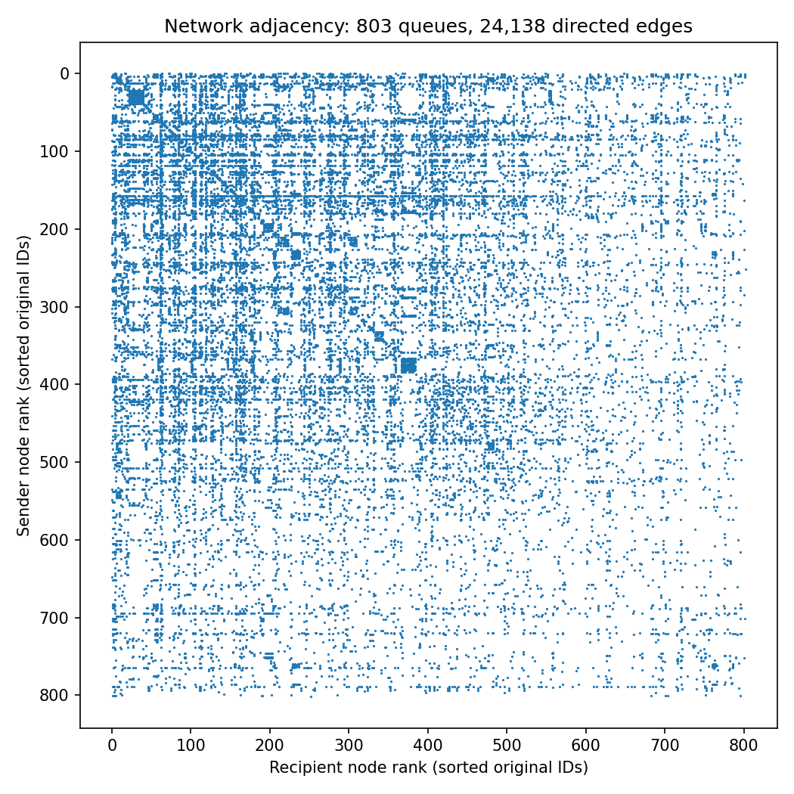
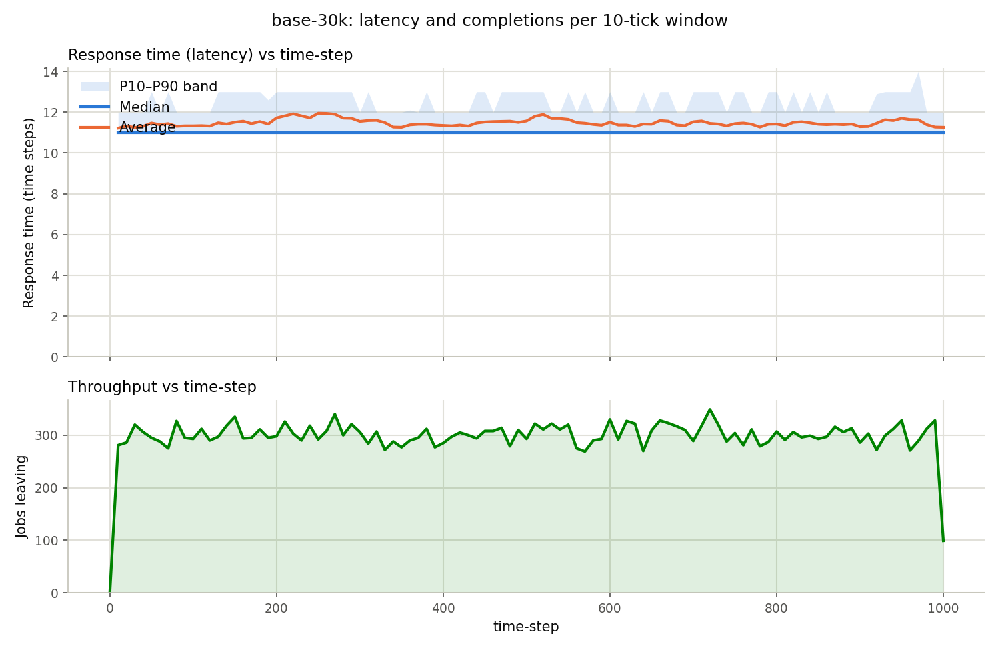
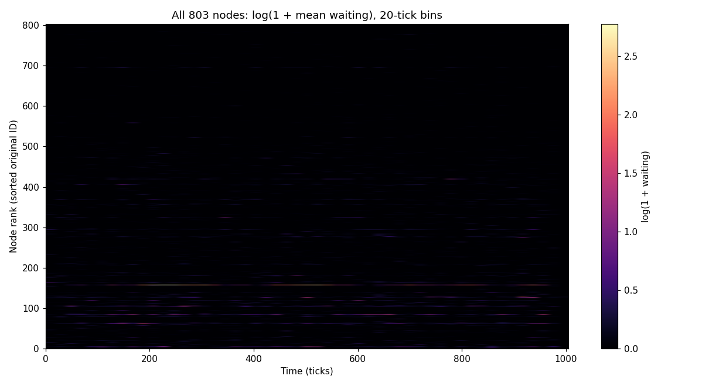
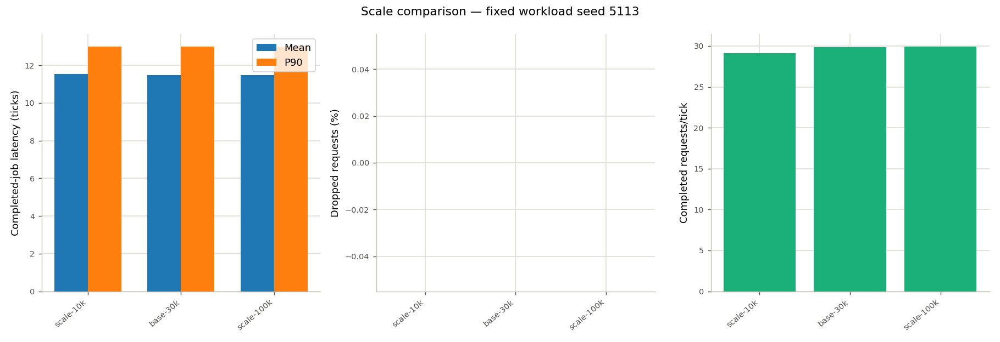
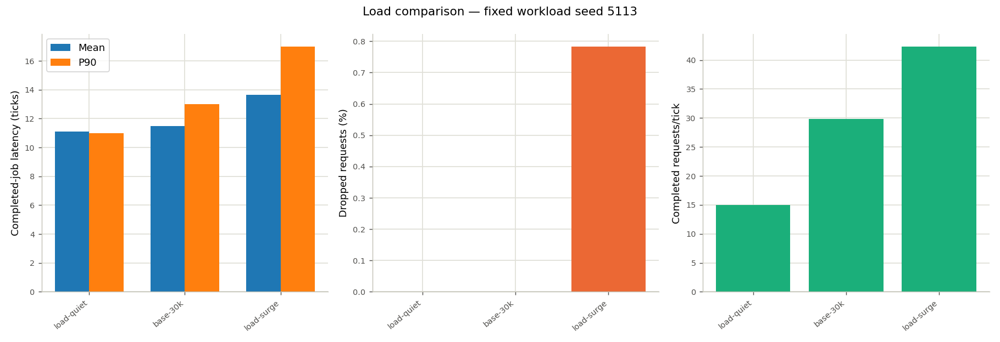
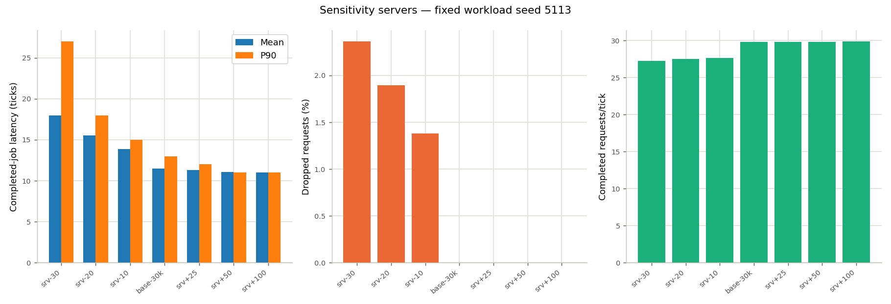
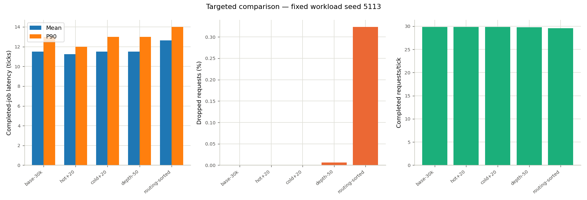

# Objective F (MEDIUM): work requests on an email communication network

**Scale:** 803 queue systems; 10,000–100,000 requests per run.  
**Reproduce:** `python3 run_analysis.py` (see §9).  
**Structure:** adapted from `ObjF_multi_SMALL`.

This study follows the SMALL branch's model → scenarios → dashboards → comparisons → conclusions approach, using the validated email network. This report uses a two-server baseline for the sensitivity experiments. The existing directory location was retained.

## 1. The real problem

An organization receives requests that need several colleagues to contribute before completion. Each colleague has limited processing capacity and a finite inbox. Handoffs follow existing communication relationships. The questions are: where does waiting accumulate, how does increasing demand affect completion, and where should extra processing resources go?

The topology comes from [SNAP's email-Eu-core network](https://snap.stanford.edu/data/email-Eu-core.html), recorded at a European research institution. An edge means one member sent another at least one email. We retain the largest strongly connected component and remove self-loops:

| Property | Value |
|---|---:|
| Original nodes / directed edges | 1,005 / 25,571 |
| Selected nodes | 803 |
| Removed self-loops within selected component | 591 |
| Retained directed edges | 24,138 |
| Strongly connected after processing | Yes |

Every retained edge comes from the dataset, and every retained node can reach every other. Original IDs remain visible as `q<ID>`. Selecting the component excludes 202 peripheral nodes; this is a study of its connected core.

**The communication topology is real; the work-request process is hypothetical.** The data does not measure request arrival rates, processing effort, buffer sizes, or routing probabilities. We specify those assumptions below. Results are conditional on this model, not estimates of the actual institution's productivity. SNAP credits Yin, Benson, Leskovec, and Gleich, "Local Higher-order Graph Clustering" (KDD 2017). The source checksum is checked by `email_model.graph()` on every run.



### File storage

The input graph is saved as readable `data/email-Eu-core.txt` (192,698 bytes). SNAP distributes it as gzip, but this file is small enough to keep uncompressed. The driver reads the plain text and verifies its SHA-256 checksum.

The larger run archives remain compressed: approximately 192 MB on disk versus 1.27 GB expanded across the study. Compression saves storage; it is not required to process the files. Python and pandas read the compressed logs and CSVs directly, and the driver restores completion files when validating saved runs.

## 2. Mapping the process onto queues

| Real-world interpretation | Queueing representation |
|---|---|
| Colleague's processing inbox | A FCFS queue system |
| Work request | A job requiring four processing visits |
| Available processing resources | Parallel servers, two per node at baseline |
| Local contribution | Two ticks of service, removing one unit of work |
| Handoff to another colleague | Directed edge from the observed graph |
| Handoff overhead | One tick in transit |
| Inbox capacity | 32 waiting jobs per node, excluding jobs in service |
| Overflow | Immediate rejected request, `ERROR QUEUE-FULL` |
| Completed request | Departure through the sink at its fourth processing node |

A request may revisit a node. Four visits are a bounded synthetic workflow, not four guaranteed distinct employees. Every node has an external source and a completion sink. Service and handoff times are in abstract ticks; no conversion to minutes is claimed.

Without waiting, a completed request takes `4 × 2 + 3 × 1 = 11` ticks. Additional servers can remove waiting but cannot lower that floor.

## 3. Metrics that matter

- **End-to-end latency:** source arrival to sink, computed only for completed jobs; mean, median, P10 and P90.
- **Throughput:** completed jobs divided by the full observed horizon, including startup and drain.
- **Drops:** count and fraction of all generated requests. Always read this alongside latency, because rejecting slow jobs can make completion latency look better.
- **Utilization:** busy server count divided by configured servers, averaged over time.
- **Saturation:** mean number waiting, plus maximum waiting and visit waiting times.
- **Errors:** drops per tick; rolling averages over 10, 100 and 1,000 ticks.
- **Conservation and Little's law:** all jobs terminate exactly once; per-node integrated occupancy equals event-derived visit duration. Network occupancy also includes jobs in transit and lifetimes of dropped jobs.

## 4. Mapping onto the simulator

### Configuration and routing

[email_model.py](email_model.py) reads and checksum-validates the source graph, builds the scenarios, writes workloads, and generates the engine's nine-column configuration CSV. Each CSV under `configs/` lists the queue capacities, servers, workloads, and routes.

A task starts at `W 4`. The bare function `Sub-1`, with rate 2, processes one contribution and releases the job. A trailing `*` would finish the job at its first node and would defeat this network model. Sinks accept only jobs whose remaining work is empty.

The engine maps weights to integer slots with `weight × 1000`. We encode equal weights as `0.001` so each neighbor gets one turn. Default weight `1` would send 1,000 successive handoffs to the same neighbor. For the new study, each node's neighbor order is shuffled once using a fixed topology seed, then reused across scenarios. This reduces synchronized preference for low-ID neighbors without changing the topology. Routing remains deterministic and independent of job content. `routing-sorted` measures the effect of sorting neighbors by node ID.

### Workload and scale

The external workload has exponential interarrival times with a mean of `1/30` tick. Cumulative arrival times are floored to simulator ticks. Requests are assigned uniformly to the 803 sources and all need four visits. Independent RNG streams for arrival times and source choices ensure the 10k and 30k streams are exact prefixes of the 100k stream. Seed: **5113**.

- **Scale:** 10k / 30k / 100k jobs at the same offered rate.
- **Load:** the same 30k requests at 0.5× / 1× / 1.5× arrival intensity, by rescaling continuous arrival times before rounding.
- **Servers:** −30%, −20%, −10%, +25%, +50%, +100% of the network-wide server budget.
- **Targeted changes:** add one server to each of the 20 highest-waiting baseline nodes, add the same budget to 20 lowest-waiting nodes, halve waiting capacity, or change routing order.

### Resource rounding

The baseline has 1,606 servers, two at every node. Targets are rounded to the nearest integer. Allocate the floor of each node's proportional share, then give remaining servers to nodes in a fixed seeded order. Every node keeps at least one server. Requested and achieved resource percentages appear in `results/summary.csv`; individual counts appear in each config. This is a network-wide budget study, not an exact percentage change at every node.

Targeted nodes are chosen by full-run baseline mean waiting, with original ID breaking ties. Those scenarios use the same workload that identified the nodes, so their benefit is an in-sample result. An independent-seed validation would be needed before claiming a general allocation rule.

### Startup and drain

Overall results use the full run through the last departure or drop. Per-node tables additionally show an **interior window**, from 10% to 90% of the external arrival horizon. We do not assume that this window proves steady state. The last-arrival time is recorded in each summary CSV. Rolling USE uses partial windows at startup; short runs do not contain many complete 1,000-tick windows.

## 5. How to read the plots and accessory outputs

Each `results/<scenario>/` directory mirrors the SMALL branch's dashboard layout:

| Artifact | Purpose |
|---|---|
| `resplot.png` | Shared system plot: latency mean/median/P10–P90 and completion counts per 10-tick window |
| `use-utilization.png` | Busy-server fraction at the 12 nodes with highest mean waiting |
| `use-saturation.png` | Waiting requests at those same nodes |
| `use-errors.png` | Drop rate at those nodes, in three rolling windows |
| `per-queue.csv` | All 803 nodes, utilization, waiting, drops, interior statistics and full-run Little's law |
| `etrace.png` | Selected latency quantiles and one dropped job, when present |
| `trace-jobs.log` | Filter-by-job output used to construct the trace |
| `pretty-events.txt` | Aligned readable event listing for selected jobs |
| `filtered-queue.csv` | Filter-by-queue output for the highest-waiting node |
| `summary.csv` | Scenario-wide measurements |

The baseline also includes visit arrival histograms and wait/turnaround scatter plots pooled over the 12 selected queues, a full-workload histogram and a reproducible 1,000-request workload scatter sample, and a heatmap covering **all 803 queues**. Top-12 selections can differ between scenarios; they are the first 12 rows of `per-queue.csv` when sorted by descending `mean_waiting`, then ascending `queue`. The plot titles identify each queue. All-node rolling USE data is retained in `runs/<scenario>/quse.csv.gz`.

The shared trace uses absolute simulation time. Circles mark queue arrivals, triangles mark task starts, squares mark server exits, and stars mark departures (both internal handoffs and sink completions). The tool includes error events in each job's time bounds but does not draw a separate error marker; inspect `trace-jobs.log` or `pretty-events.txt` for drop details. The sampled jobs illustrate selected latency quantiles plus a dropped job when available; they are not a random population sample.

<!-- GENERATED RESULTS -->
## 6. Results

These are measured results from one matched workload seed. System dashboard throughput is a completion count per 10-tick window; summary-table throughput is completions per tick over the full run. Decimal places support reproducibility; they do not represent uncertainty bounds. Latency values are ticks, drop percentages use all generated jobs, and throughput is completed requests per tick over the entire run.

### 6.1 Baseline: 30,000 work requests



All 30,000 requests completed, with 0 drops. Mean latency was **11.488 ticks**, median **11**, and P90 **13**. Throughput was **29.851 completed requests/tick**. Mean waiting across a completed journey was 0.488 ticks above the 11-tick no-waiting floor.

The six nodes with highest full-run mean waiting were:

| queue | servers | utilization | mean_waiting | errors | mean_wait | p90_wait | L | lambda_W |
|---|---|---|---|---|---|---|---|---|
| 160 | 2 | 0.905 | 3.887 | 0 | 4.292 | 11.000 | 5.698 | 5.698 |
| 86 | 2 | 0.687 | 0.732 | 0 | 1.067 | 3.000 | 2.105 | 2.105 |
| 5 | 2 | 0.686 | 0.525 | 0 | 0.766 | 2.000 | 1.897 | 1.897 |
| 107 | 2 | 0.635 | 0.494 | 0 | 0.777 | 3.000 | 1.763 | 1.763 |
| 62 | 2 | 0.682 | 0.489 | 0 | 0.717 | 2.000 | 1.852 | 1.852 |
| 129 | 2 | 0.561 | 0.347 | 0 | 0.619 | 2.000 | 1.470 | 1.470 |

Node q160 had the largest mean waiting queue. It is the strongest local congestion candidate in this run, although the network completed every request. The all-node heatmap and USE panels show why a network-wide average alone would obscure this concentration.



### 6.2 Scale: 10k / 30k / 100k requests



| scenario | jobs | total_servers | latency_mean | latency_p90 | drop_pct | throughput |
|---|---|---|---|---|---|---|
| scale-10k | 10000 | 1606 | 11.542 | 13.000 | 0.000 | 29.155 |
| base-30k | 30000 | 1606 | 11.488 | 13.000 | 0.000 | 29.851 |
| scale-100k | 100000 | 1606 | 11.493 | 13.000 | 0.000 | 29.949 |

Mean latency is similar across these runs and P90 is 13 ticks in each. Increasing the job count at fixed arrival intensity mainly lengthens the observation period. Full-run throughput approaches the offered rate as startup and drain become a smaller share. This is evidence of consistent behavior over these finite runs, not a proof of steady-state stability.

### 6.3 Load: the same requests at half and 1.5 times the intensity



| scenario | jobs | total_servers | latency_mean | latency_p90 | drop_pct | throughput |
|---|---|---|---|---|---|---|
| load-quiet | 30000 | 1606 | 11.090 | 11.000 | 0.000 | 15.030 |
| base-30k | 30000 | 1606 | 11.488 | 13.000 | 0.000 | 29.851 |
| load-surge | 30000 | 1606 | 13.667 | 17.000 | 0.783 | 42.340 |

The quiet case approaches the 11-tick service-and-transfer floor. The surge case has mean latency **13.667 ticks**, P90 **17**, and **235 drops (0.783%)**. It processes more requests per tick because demand is greater, but some buffers fill. Thus higher measured throughput does not by itself mean better service.

### 6.4 Sensitivity: −30% through +100% servers



| scenario | requested_resource_change_pct | actual_resource_change_pct | total_servers | latency_mean | latency_p90 | drop_pct | throughput |
|---|---|---|---|---|---|---|---|
| srv-30 | -30.000 | -30.012 | 1124 | 17.961 | 27.000 | 2.363 | 27.273 |
| srv-20 | -20.000 | -19.988 | 1285 | 15.560 | 18.000 | 1.893 | 27.507 |
| srv-10 | -10.000 | -10.025 | 1445 | 13.883 | 15.000 | 1.380 | 27.650 |
| base-30k | 0.000 | 0.000 | 1606 | 11.488 | 13.000 | 0.000 | 29.851 |
| srv+25 | 25.000 | 25.031 | 2008 | 11.320 | 12.000 | 0.000 | 29.851 |
| srv+50 | 50.000 | 50.000 | 2409 | 11.056 | 11.000 | 0.000 | 29.851 |
| srv+100 | 100.000 | 100.000 | 3212 | 11.010 | 11.000 | 0.000 | 29.880 |

At the largest cut, **1,124 servers** produce **709 drops (2.363%)**, mean completion latency **17.961 ticks**, and throughput **27.273**. The exact node allocations are in the scenario configs; cuts affect a seeded subset of nodes because resources are discrete.

Added servers have limited room to improve the baseline because it already completes all arrivals near the 11-tick floor. They primarily reduce waiting rather than create more demand. The drop column is necessary when interpreting cuts: latency excludes rejected jobs.

### 6.5 Targeted alternatives and routing



| scenario | jobs | total_servers | latency_mean | latency_p90 | drop_pct | throughput |
|---|---|---|---|---|---|---|
| base-30k | 30000 | 1606 | 11.488 | 13.000 | 0.000 | 29.851 |
| hot+20 | 30000 | 1626 | 11.231 | 12.000 | 0.000 | 29.851 |
| cold+20 | 30000 | 1626 | 11.488 | 13.000 | 0.000 | 29.851 |
| depth-50 | 30000 | 1606 | 11.499 | 13.000 | 0.007 | 29.789 |
| routing-sorted | 30000 | 1606 | 12.652 | 14.000 | 0.323 | 29.548 |

Adding 20 servers to the highest-waiting nodes changes mean latency from **11.488** to **11.231** ticks. The same 20-server budget at the lowest-waiting nodes gives **11.488** ticks. The targeted addition is only **1.245%** of baseline capacity. These nodes were selected using the baseline itself, so this comparison needs held-out workloads before it supports a general staffing rule.

The depth scenario changes waiting slots, leaving service capacity unchanged. Read its latency and drop percentage together. Sorted-neighbor routing gives **12.652 ticks** mean latency and **0.323%** drops. It preserves the same graph and long-run equal-neighbor routing policy, but changes transient handoff order. This comparison demonstrates why initialization choices belong in the model description.

## 7. Does this make sense for the real problem?

Within the stated hypothetical workflow, yes: concentrated incoming handoffs create local waiting; more demand can fill finite inboxes; capacity at already-idle nodes contributes little; and more servers cannot eliminate the fixed work and transfer time.

The model does not include priorities, worker skills, deadlines, correlated tasks, retries, or time-varying staffing. Four identical contributions simplify real workflows considerably. An observed email edge only demonstrates past communication; it does not prove that either colleague can process every request. Uniform external origins and deterministic equal routing are assumptions. No real-world operational recommendation or wall-clock forecast follows directly from these synthetic numbers.

The workload seed is shared across scenarios. Arrival times, source assignments and processing requirements are matched, but changing capacity can change which job receives the next round-robin edge. Therefore exact job routes need not stay identical between server scenarios. No confidence intervals are claimed from this one-seed comparison.

## 8. Takeaways

1. **Inspect individual queues.** Network-average spare capacity can coexist with localized waiting.
2. **Distinguish scale from load.** More requests at the same rate lengthen a run; faster arrivals stress capacity.
3. **Place resources where waiting occurs.** Compare the same extra-server budget at busy and quiet nodes before assuming a uniform increase is efficient.
4. **Report drops beside latency.** A request that overflows an inbox disappears from completion latency but remains an unmet request.
5. **Respect the 11-tick floor.** Once waiting is small, shorter processing or fewer handoffs are the remaining latency levers in this model.
6. **Validate routing assumptions.** A harmless-looking neighbor order can change finite-run congestion even with identical graph edges.
7. **Validate job accounting.** Finished simulations alone are insufficient; drops, transit, completion sinks and queue-time integrals must agree.

## 9. Artifacts, validation, and reproduction

```text
multi-MEDIUM/
  README.md               this SMALL-style report
  email_model.py         observed graph, synthetic model, scenario/config writers
  analysis_tools.py      model validation, queue summaries, USE and heatmap
  implementation_tools.py  calls shared Objective A/C/E scripts and checks outputs
  run_analysis.py        build -> smoke checks -> simulate -> analyze -> compare
  write_report.py        refresh measured results from summary CSVs
  requirements.txt       Python dependencies
  data/                  original SNAP edge list
  workloads/             simulator input streams, shared by matching scenarios
  configs/               per-scenario simulator CSVs
  results/               per-scenario dashboards and cross-scenario comparisons
  runs/                  compressed raw outputs, derived metrics and sink archives
```

The SNAP edge list is included. If it is missing, the driver downloads it and verifies its checksum.

From this directory:

```sh
python3 -m pip install -r requirements.txt
python3 run_analysis.py --list
python3 run_analysis.py
python3 run_analysis.py --scenarios base-30k,srv+50
python3 run_analysis.py --scenarios base-30k --skip-sim
python3 write_report.py
```

Requires a C++17 compiler named `c++`. The driver builds the repository's existing simulator into the temporary directory. It raises the Unix file-descriptor limit when available so 803 sources and sinks can be open together. Workload/config paths are relative to this directory, and the driver sets that working directory automatically. Normal reruns overwrite generated files; `--skip-sim` compares the saved config and workload files with the current model before reusing the raw run. Run without Python's `-O` because validation uses assertions.

Run `base-30k` before targeted `hot+20`/`cold+20` if starting without results. Compressed raw logs are `events.log.gz` and `qmet.csv.gz`; completion files are in `sinks.tar.gz`. The driver temporarily restores these files when revalidating. All artifacts are retained within this analysis directory, and its `.gitignore` overrides the repository's blanket exclusion of `runs/`.

### Validation

Checks run in memory and stop the pipeline if they fail; no verification JSON or tool logs are written. Smoke checks use a temporary directory that is removed afterward. The driver first checks a known three-node route with one job (four visits, 11 ticks), then a deliberate overflow (100 simultaneous arrivals; 33 complete and 67 are rejected). It checks graph integrity, every routing choice, every transfer delay, sink contents, four visits per completed job, service duration, queue/server bounds, full drain, and exact job conservation.

Per-node integrated waiting/service counters equal independently reconstructed event durations. Full-run `L` equals visit throughput times mean turnaround. At network level, occupancy includes transit, and the lifetime sum includes both completed and dropped requests. This avoids applying completion-only Little's law to a loss system. Source checksum and graph integrity are checked in `email_model.graph()`. The model preserves matched workload prefixes and checks server allocations when it runs.

### Accessory-tool coverage

| Capability | Implementation and saved demonstration |
|---|---|
| Workload creation and visualization | Model-specific generation; Objective A `workload_visualizer.py` produces `workload.png` and `workload-scatter.png` |
| Config from real network | `email_model.graph`, `routing`, `write_inputs`; 803-node configs |
| Multi-queue simulation | Existing Obj B C++ engine; raw events, queue metrics, sinks |
| Derive system metrics | Objective C `derive_sys_metrics.py`; `sysmetrics.csv` contains latency percentiles and completion counts per window |
| Plot system metrics | Objective C `plot_sys_metrics.py`; `resplot.png` in every scenario |
| Derive visit metrics | Objective C `derive_event_metrics.py`; `emetrics.csv.gz`, cross-checked against independent validation |
| Model job accounting | Local `derive_and_validate`; `jobs.csv.gz` tracks completed and dropped lifetimes |
| Plot visit histograms/scatter | Objective C `plot_derive_event_metrics.py`; three baseline `emetrics-*.png` plots |
| Filter by queue | Objective C `filter_by_queue.py`; `filtered-queue.csv` |
| Filter by job | Objective C `filter_by_job.py`; `trace-jobs.log` |
| Compute USE | Local helper (no shared implementation yet); all-node `quse.csv.gz`, windows 10/100/1,000; partial startup windows |
| Plot USE | Local helper (no shared implementation yet); three per-scenario top-12 panels; baseline all-node waiting heatmap |
| Create event trace | Objective C `create_event_trace.py`; `etrace.png` for the filtered jobs |
| Pretty-print events | Objective E `pretty_print_events.py`; `pretty-events.txt` with one column per queue |

`implementation_tools.py` invokes the shared scripts under `src/implementation/` as command-line tools. Failed commands report their diagnostics in the terminal. Intermediate plot inputs are temporary files and are removed after plotting. Compressed event logs are expanded in a temporary directory because the shared event CLIs read plain text. Shared visit metrics must exactly match the independent model reconstruction; system percentiles are checked within 0.0051 ticks because the shared CLI writes two decimal places. Filters are checked against the original rows and event lines. USE, model-specific validation, queue summaries, and cross-scenario comparisons remain local.

The location remains `src/analysis/ObjF/multi-MEDIUM/`, matching the directory already created on this branch. The assignment quote specifies `./analysis/multi-MEDIUM/`; reconcile that literal path before final submission. Further work could repeat the study with independent seeds and evaluate targeted allocations on held-out workloads.
