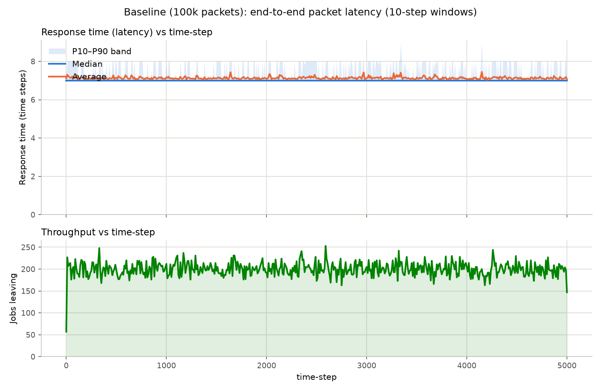
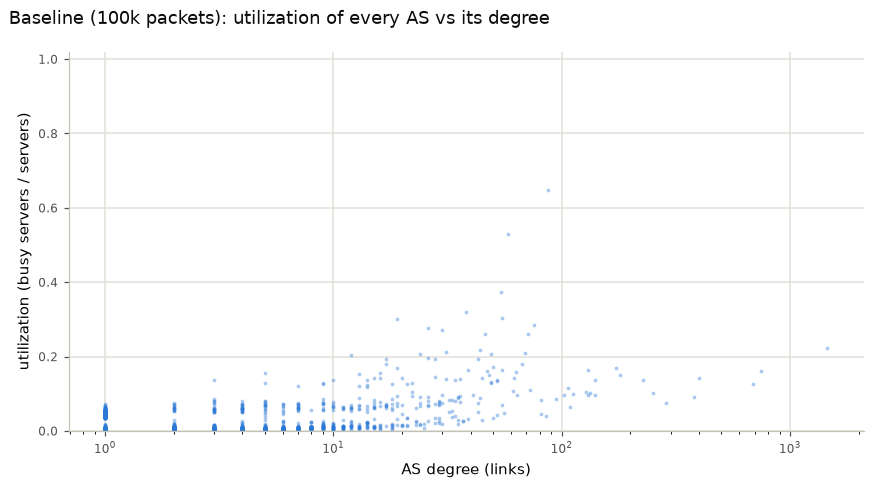
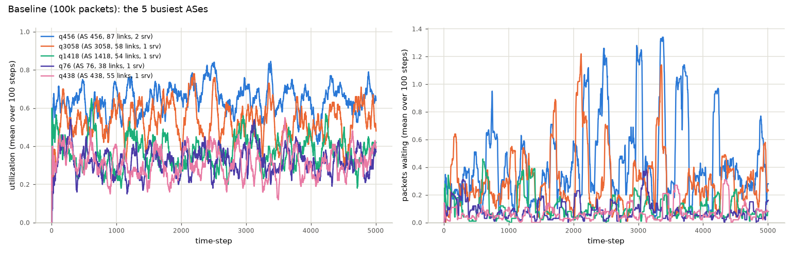
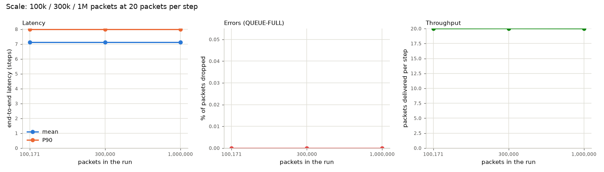
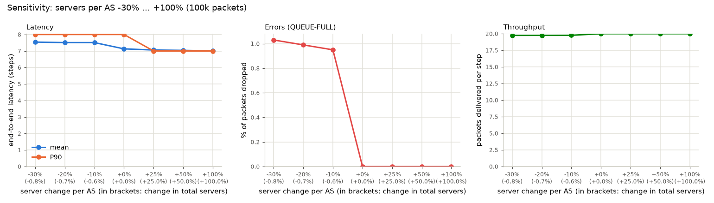

# Objective F (LARGE) — Internet packet forwarding between Autonomous Systems

**Scale:** 6,474 queue systems, 100,000–1,000,000 packets per run.
**Owner:** Felix Werner. **Reproduce:** `python run_analysis.py` (see §9).

This directory answers the "Multi Queue Modelling and Analysis" slide for the LARGE
scale: pick a real process, map it to a queueing network built from a real graph,
map that onto the simulator, run it at several scales, do the sensitivity study, and
say what you would tell the people who run the real thing.

---

## 1. The real problem

The Internet is a network of **Autonomous Systems (ASes)**: independently run
networks (ISPs, universities, companies) that exchange traffic over peering and
transit links. A packet from one edge network to another crosses a handful of ASes;
each AS forwards it on towards the next one. When an AS receives more packets than
it can forward, they wait in its buffers (latency goes up), and when the buffers are
full, packets are dropped (loss).

The questions an operator cares about:

- How much latency does the network add, end to end and per AS?
- Which ASes are the bottlenecks, and are they the ones you would expect (the big hubs)?
- How much forwarding capacity is needed, and what happens if capacity is cut or added?

The topology is real: the SNAP `as-733` snapshot of **2 January 2000**
(`as20000102.txt`, from BGP routing tables).

| graph fact | value |
|---|---|
| ASes | 6,474 (one connected component) |
| links | 12,572 (the file lists each once; 1,323 self-loops dropped) |
| stub ASes (degree 1) | 2,384 (37 %) |
| degree 2 | 2,430 |
| largest hubs | 1,458, 750, 691 links |

## 2. Mapping the Internet onto a queueing network

| Real world | Queueing network |
|---|---|
| AS | queue system (FCFS buffer + servers) |
| packet | job |
| forwarding capacity of an AS | number of servers |
| buffer | queue size; overflow = packet loss |
| link between two ASes | edge in both directions |
| edge network that sends traffic | source (500 stub ASes) |
| destination network | sink |
| AS path length | work units carried by the packet |

## 3. Metrics that matter

- **End-to-end latency**: steps from a packet entering at its source stub to leaving at
  its destination AS. Mean, median, P10 and P90 (`derive-sys-metrics`).
- **Per-AS latency**: waiting time and waiting + service per AS visit
  (`derive-event-metrics`). Shows where delay is added.
- **Packet loss**: `QUEUE-FULL` drops, in total and per AS degree class.
- **Throughput**: packets delivered per step.
- **Utilization and saturation** of every AS (from `qmet.csv`), and over time for the
  five busiest ASes (USE).

## 4. Mapping onto the simulator

| Simulator setting | Value | Why |
|---|---|---|
| queues | one per AS, `q0…q6473` (sorted AS number) | built by the Obj E `create-config-network` code |
| edges | both directions, weight `0.001` | the simulator routes by deterministic round-robin in blocks of weight × 1000; `0.001` = one slot per link, so an AS alternates between its links |
| server function | `Sub-1`, rate 1 | one visit = one step of forwarding, removes one unit of work |
| servers | `max(1, ceil(degree / 70))` | bigger ASes have more capacity; total 6,555, the hub AS 1 gets 21 |
| queue size | `max(8, 4 × servers)` | a small buffer per server |
| sources | 500 randomly chosen stubs (seed 7) | traffic starts at the edge of the Internet |
| sinks | **every AS**, each with its own `out-q<N>.wl` | see below |
| packet | one task `W 4` | done after exactly 4 AS visits |

**Why every AS is a sink.** The simulator lets a job leave only when its work is done
*and* it is at a queue with a sink. With sinks only on stubs, a finished packet kept
being forwarded until it happened to reach a stub: in a pilot only 3.5 % of packets
left after 4 visits, the mean was 14.2 visits and the maximum 93. That measured the
round-robin wandering, not the network. With a sink on every AS, every delivered
packet crosses exactly 4 ASes. The destination is wherever the 4th visit ends; the
simulator has no destination-based routing.

**Why `k = 70`.** A pilot with the wandering packets showed about 0.01 busy servers per
link in every degree class, so `k = 70` was meant to put the hubs at about 70 %. With
exact 4-hop paths the load no longer follows degree (see §6.1): the busiest AS runs at
65 %, the hubs at about 22 %.

**Workload.** The Obj A generator (imported in-process) writes one Poisson stream per
source stub, 0.04 packets per step each, so 20 packets per step in total. Every
generator file numbers its jobs from `j0`, so `as_model.py` renumbers them globally
(file 2 continues where file 1 stopped); otherwise the same id would enter from 500
places and the per-job tools would mix packets up. The baseline is 100k packets over
5,000 steps; the scale runs keep 20 packets per step and run longer.

## 5. How to read the plots

Each `results/<scenario>/` folder holds:

| file | shows |
|---|---|
| `resplot.png` | end-to-end latency (mean, median, P10–P90) and throughput per 10-step window |
| `util-vs-degree.png` | utilization of every AS against its number of links |
| `util-cdf.png` | how utilization is spread across all 6,474 ASes |
| `drops-by-degree.png` | dropped packets per degree class |
| `top5-use.png` | utilization and waiting packets over time for the 5 busiest ASes |
| `per-queue.md` | the 20 busiest ASes: load, drops, per-visit latency |
| `trace-jobs.log` | full event trace of the fastest, median and slowest packet |
| `summary.csv` | the scenario's headline numbers |

`results/summary.md` compares all scenarios; `sensitivity-servers.png` and
`scale-comparison.png` plot latency, loss and throughput across them.

## 6. Results

All numbers are from `results/summary.md`; latency is in simulator steps.

| scenario | total servers | packets | dropped | latency mean / P90 | busiest AS (utilization) | hub AS 1 |
|---|---|---|---|---|---|---|
| base-100k | 6,555 | 100,171 | 2 | 7.13 / 8 | AS 456 (65 %) | 22 % |
| scale-300k | 6,555 | 300,333 | 8 | 7.13 / 8 | AS 456 (64 %) | 22 % |
| scale-1m | 6,555 | 999,822 | 15 | 7.13 / 8 | AS 456 (63 %) | 22 % |
| srv-10 | 6,514 | 100,171 | 954 (0.95 %) | 7.51 / 8 | AS 456 (99 %) | 27 % |
| srv-20 | 6,508 | 100,171 | 990 (0.99 %) | 7.51 / 8 | AS 456 (99 %) | 31 % |
| srv-30 | 6,501 | 100,171 | 1,030 (1.03 %) | 7.54 / 8 | AS 456 (99 %) | 36 % |
| srv+25 | 8,194 | 100,171 | 0 | 7.06 / 7 | AS 3058 (53 %) | 17 % |
| srv+50 | 9,832 | 100,171 | 0 | 7.04 / 7 | AS 456 (43 %) | 15 % |
| srv+100 | 13,110 | 100,171 | 0 | 7.01 / 7 | AS 456 (32 %) | 11 % |

### 6.1 Baseline: 100k packets, 5,000 steps



- **Latency is at the floor.** A packet needs 4 visits of 1 step plus 3 transfers of
  1 step, so 7 steps is the minimum. The mean is 7.13 and the P90 is 8: only 2.9 % of
  AS visits had to wait at all. Throughput is 20 packets per step, equal to the
  arrival rate.
- **The network is lightly loaded.** The mean utilization over all 6,474 ASes is 1 %
  (`util-cdf.png`). Only 2 packets were dropped, both at AS 456.
- **The bottleneck is not the biggest hub.** The busiest AS is AS 456 (87 links,
  2 servers) at 65 %, followed by AS 3058 (58 links, 1 server) at 53 %. The hub AS 1
  (1,458 links, 21 servers) runs at 22 % (`util-vs-degree.png`, `per-queue.md`).
  With exact 4-hop paths starting at stubs, traffic concentrates on the ASes next to
  the sources, and degree does not predict that. Degree-based sizing therefore gives
  the hubs spare capacity while some mid-size ASes run hot.





### 6.2 Scale: 100k / 300k / 1M packets



The three runs keep 20 packets per step and only run longer (5,000 / 15,000 / 50,000
steps). Latency (7.13 / 8), throughput (20 per step) and the busiest AS (AS 456 at
63–65 %) are the same at every size, and the drop rate stays below 0.003 %. The
network is in a steady state: more packets at the same rate do not build up queues.
The 1M run took 3.5 minutes to simulate and about 2.5 minutes for the Obj C tools.

### 6.3 Sensitivity: servers per AS −30 % … +100 %



**How the minus side works.** Every AS keeps at least 1 server, and with `k = 70`
6,446 of the 6,474 ASes have exactly 1. A cut therefore only reaches the 28 ASes with
more than one server: each of them is cut to `floor(servers x factor)` (at least 1), and
some lose one more server.
That is about −10 / −20 / −30 % *per AS*, but only −0.6 / −0.7 / −0.8 % of the
*total*, which the brackets on the x-axis show. The hub AS 1 goes from 21 to
17 / 15 / 13 servers.

- **Any cut breaks AS 456.** Already at −10 % it goes from 2 servers to 1 and
  saturates at 99 %. It then causes almost all the loss: in `srv-30`, 933 of the
  1,030 drops are at AS 456, and its mean waiting time per visit grows from 0.34 to
  6.4 steps. Loss is about 1 % in all three minus runs, and the mean latency rises from
  7.13 to about 7.5.
- **The hubs barely notice.** AS 1 goes from 22 % to 36 % utilization at −30 %, still
  far from saturated.
- **Adding servers buys almost nothing.** At +25 % no packet is dropped and the P90
  falls to the 7-step floor; +50 % and +100 % only lower utilization further
  (AS 456: 43 %, 32 %). Throughput stays at 20 packets per step everywhere.

## 7. Does this make sense for the real Internet?

- **Yes, qualitatively.** Backbone networks are commonly over-provisioned and run at low
  average utilization, with congestion at a few specific links or networks rather than
  everywhere. The model reproduces that: a 1 % average, one hot AS.
- **The hot spot is an artefact of the routing.** Real inter-AS routing follows BGP
  policy and shortest paths, so traffic would concentrate on the large transit hubs.
  The simulator forwards round-robin, so a packet's next hop depends only on which
  link is next in turn, and the ASes next to the source stubs get the most traffic.
- **Paths are fixed at 4 ASes.** Real AS paths vary; 4 is a typical length.
- **There is no propagation delay.** Every transfer takes 1 step, so latency here is
  forwarding and queueing only.

## 8. Takeaways for someone running this network

- **Size capacity from measured traffic, not from size.** Degree-based capacity left
  the biggest hub at 22 % while a mid-size AS ran at 65 % and became the only point of
  loss.
- **Watch the ASes with little spare capacity.** AS 456 runs on 2 servers; losing one
  of them is enough to drop about 1 % of all packets, while cutting the hub by a third
  changes nothing visible.
- **Extra capacity everywhere is wasted.** Doubling all servers improved mean latency
  from 7.13 to 7.01 steps. One more server at AS 456 would be the targeted fix (not simulated here).
- **The network scales with the number of packets** as long as the rate per step stays
  the same: 1M packets behaved exactly like 100k.

## 9. Artifacts and how to reproduce

```text
as20000102.txt       SNAP as-733 snapshot (input graph)
as_model.py          graph -> config (Obj E), workloads (Obj A), scenarios
large_tools.py       all-AS aggregation, plots, tables (imports multi-SMALL/analysis_tools.py)
run_analysis.py      driver: generate -> simulate -> Obj C tools -> plots -> summary
configs/base.md      base configuration summary (configs/*.csv are git-ignored)
workloads/           generated packet streams (git-ignored, regenerated from the seeds)
runs/                simulator output per scenario (git-ignored, ~12 GB for all scenarios)
results/             plots + tables per scenario, cross-scenario comparisons, summary.md
```

```bash
# build the simulator once (see src/implementation/obj-b/simple-queue-sim/README.md)
cd src/analysis/multi-LARGE
python run_analysis.py --list
python run_analysis.py                        # all 9 scenarios
python run_analysis.py --scenarios base-100k  # one scenario, ~2 min
python run_analysis.py --skip-sim             # re-plot from existing runs/
```

Requires Python 3 with `numpy`, `pandas` and `matplotlib`.

**Tool coverage.** Every run uses the Obj C CLIs: `derive-sys-metrics`,
`plot-sys-metrics`, `derive-event-metrics`, `filter-by-queue` (the 5 busiest ASes) and
`filter-by-job` (trace packets). USE is computed with `compute_use` from
`multi-SMALL/analysis_tools.py`.
