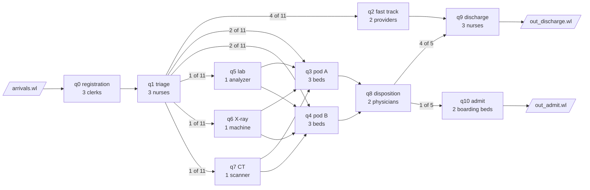
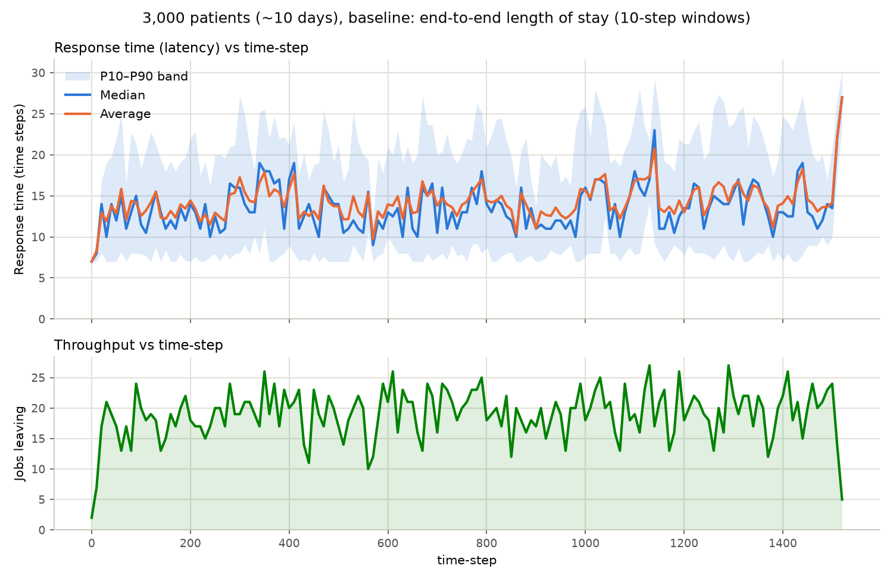
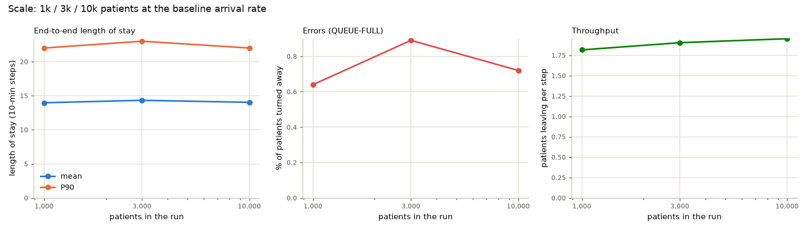
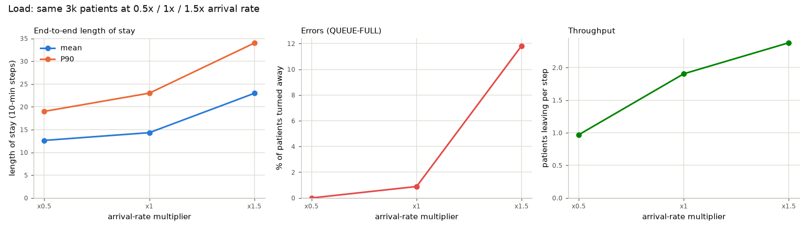
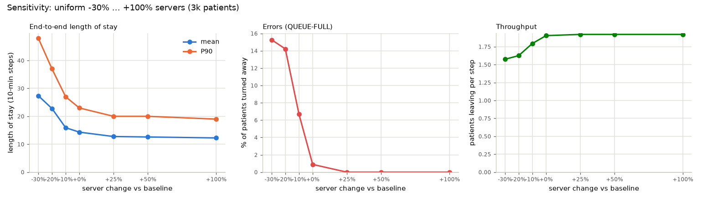
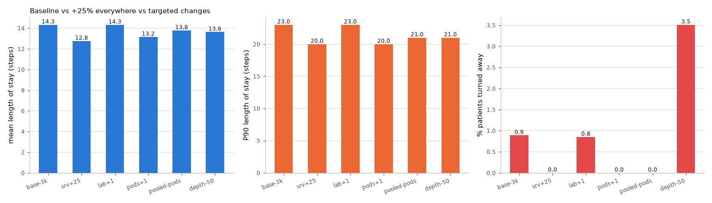

# Objective F (SMALL) — an emergency department as a network of queues

**Scale:** 11 queue systems, 1,000–10,000 patients per run.
**Owner:** Caleb Furley. **Reproduce:** `python run_analysis.py` (see §9).

This directory answers the "Multi Queue Modelling and Analysis" slide for the SMALL
scale: pick a real process, map it to a queueing network, map that onto the
simulator, run it at several scales, do the sensitivity study, and say what you would
tell the people who run the real thing.

---

## 1. The real problem

A hospital **emergency department (ED)**. Patients arrive around the clock, register,
are triaged by a nurse, and are then treated in a fast-track area (minor complaints)
or in one of two treatment pods (everyone else). Some patients are sent for lab work,
an X-ray or a CT scan before they see a physician. After treatment, a physician
decides on a disposition: most patients go home, some are admitted and wait for an
inpatient bed ("boarding").

EDs are a textbook queueing network because every resource is finite and shared,
patients take different paths, and the thing everyone complains about, waiting, is the
direct consequence of utilisation. The things a hospital tracks are also exactly what
the lab's tools produce: **length of stay** (end-to-end response time),
**door-to-provider time** (waiting time at the treatment queue), **left without being
seen / diversion** (patients turned away = errors), **bed utilisation** and
**boarding**.

## 2. Mapping the ED onto a queueing network



| Real-world thing | Simulator thing |
| --- | --- |
| Patient | **Job**. One patient stream enters at registration; every other hop is an internal edge. |
| Care a patient needs | **Tasks**: a list of care steps, each with a work value `W` = units of staff attention (1 unit ≈ 10 min). Drawn from the Obj A generator (Poisson, λ = 2, clamped ≥ 1), so most patients need 1–4 steps of 1–4 units and a few need a lot more. |
| Station (desk, triage bay, pod, lab, …) | **Queue system**. Its servers are the clerks / nurses / beds / machines. |
| A station that does a fixed piece of work and hands the patient on | Bare `Sub-X` at rate `r`: X units of attention in `r` steps, then the patient leaves along an outgoing edge. |
| A station that keeps the patient until their care is complete | `Sub-X*`: repeat X units every `r` steps until `Tasks == []`. Used for the fast track, the pods, discharge and admit. |
| Waiting room / hallway space | `Queue Max Size`. A patient who cannot fit is turned away (`ERROR QUEUE-FULL`) — the ED's *left-without-being-seen* or *ambulance diversion* outcome. |
| Triage decision | Outgoing edge weights on `q1` (fast track 4 : pod A 2 : pod B 2 : lab 1 : X-ray 1 : CT 1). Diagnostics ordered at triage return the patient to a pod. |
| Disposition decision | Edge weights on `q8` (discharge 4 : admit 1). |
| Discharge home / admission to the hospital | The two **sinks**, `out_discharge.wl` and `out_admit.wl`. |
| One time step | **10 minutes**. 1,500 steps ≈ 10.4 days. |

Full station table for the baseline: [`configs/base-3k.md`](configs/base-3k.md); the
simulator config: [`configs/base-3k.csv`](configs/base-3k.csv).

Simplifications worth knowing: routing is blind to the patient (the simulator picks
edges by weight, not by acuity), service times are deterministic given the task list,
there is no day/night pattern in arrivals, and admitted patients leave the model when
their boarding time ends rather than when an inpatient bed frees up.

## 3. Metrics that matter

| Metric | ED name | Where it comes from |
| --- | --- | --- |
| End-to-end response time (arrival → sink), mean / median / P10 / P90 | **Length of stay (LOS)** | `derive-sys-metrics` → `sysmetrics.csv`, plotted by `plot-sys-metrics` |
| Throughput (patients leaving per step) | Patients treated per hour | same |
| Waiting time per visit at q2/q3/q4 | **Door-to-provider time** | `derive-event-metrics` → `emetrics.csv` (`time-in-queue`) |
| Utilisation per station | Bed / staff occupancy | USE from `qmet.csv` (`num-jobs-in-service / servers`) |
| Saturation per station | Patients waiting (hallway) | USE from `qmet.csv` (`num-jobs-in-queue`) |
| Errors per station | **Left without being seen / diversion** | USE from `qmet.csv` (`num-of-errors`), `ERROR QUEUE-FULL` lines |
| Little's law check `L = λ·W` | sanity check of the model and the tools | `qmet.csv` (L) vs `emetrics.csv` (λ, W) |

## 4. Mapping onto the simulator

**Configuration.** [`ed_model.py`](ed_model.py) holds the network as data (a
`Station` per row) and writes `qconf.csv` for every scenario. All paths in the configs
are relative to this directory; the driver runs the simulator from here.

**Routing weights.** The Obj B simulator turns each edge weight into
`int(weight × 1000)` slots and walks them *sequentially*, so a weight of `1.0` sends
1,000 consecutive patients down one edge before switching. To get an interleaved split
every weight in these configs is a slot count divided by 1000: `q2:0.004,q3:0.002`
means "4 to q2, then 2 to q3, repeat". (Worth fixing in the simulator; the encoding
here keeps working if it is.)

**Workload and why.** `workload_generator.py --dist poisson --lam 2 --seed 4113`.
Poisson arrivals are the standard model for independent walk-ins, and the generator
draws task count and work from the same distribution, which gives a realistic skew
(many quick patients, a tail of complex ones). λ = 2 per 10 minutes = 288 patients a
day, a mid-size ED. Scale and load are then varied *without changing the patient mix*:

- **Scale** (how many patients): generate 500, 1,500 or 5,000 steps with the same seed
  (the shorter streams are prefixes of the longer one) → ~1k, ~3k, ~10k patients.
- **Load** (how fast they arrive): keep the 3k-patient stream and multiply arrival
  times by 2 (half the load) or by ⅔ (1.5× the load).

**Capacity.** Servers per station were chosen so the baseline is *busy but stable*:
the pods, the real ED bottleneck, run at ≈85 % occupancy and turn away under 1 % of
patients; everything else sits at 35–75 %.

**Warm-up and drain.** Steady-state station statistics use the middle 80 % of the
horizon. The end of every response-time plot shows a spike: the last few patients
(mostly admitted ones with a 60-minute boarding step) are averaged over a nearly empty
system. That is the drain, not a finding.

**Sensitivity knobs.** "Resources" are servers (primary study), waiting capacity
(`depth-50`), and links/topology (`pooled-pods`). Because stations have 1–3 servers, a
uniform "−10 % per station" rounds back to the baseline, so the ±% study scales the
**total** server count and apportions it (largest-remainder; ties go to the smallest
station). The resulting counts are in the table in §6.4.

## 5. How to read the plots

Each `results/<scenario>/` folder holds the same dashboard:

| File | Tool | What it shows |
| --- | --- | --- |
| `resplot.png` | `derive-sys-metrics --window 10 --dense` + `plot-sys-metrics` | LOS median/average with a P10–P90 band, and throughput, per 100 minutes |
| `use-utilization.png`, `use-saturation.png`, `use-errors.png` | USE (sliding windows 10 / 100 / 1000 steps, one panel per station) | which stations are busy, where patients pile up, where patients are turned away |
| `etrace.png` | event trace of nine patients (fastest, typical, slowest, one turned away) | where the time goes inside a journey |
| `per-queue.md` | per-station table incl. Little's law | numbers behind the plots |
| `emetrics-*.png` (baseline only) | `derive-event-metrics` + histogram / scatter | waiting time per visit vs arrival time, per station |

Read USE and the response/throughput panels together: rising latency with flat
throughput means work is queueing, not completing faster; errors appearing means the
queue in front of a saturated station has overflowed.

## 6. Results

### 6.1 Baseline: 3,000 patients, ~10 days



| Station | servers | utilisation | mean waiting (patients) | turned away | mean wait | P90 wait | L measured | λ·W |
| --- | --- | --- | --- | --- | --- | --- | --- | --- |
| q0 registration | 3 | 0.66 | 0.49 | 0 | 2.5 min | 10 min | 2.46 | 2.46 |
| q1 triage | 3 | 0.65 | 0.00 | 0 | 0 | 0 | 1.96 | 1.96 |
| q2 fast track | 2 | 0.63 | 0.45 | 0 | 6 min | 20 min | 1.72 | 1.72 |
| q3 pod A | 3 | **0.85** | **1.63** | **13** | **27 min** | **60 min** | 4.18 | 4.18 |
| q4 pod B | 3 | **0.82** | **1.35** | **13** | **22 min** | **60 min** | 3.82 | 3.83 |
| q5 lab | 1 | 0.71 | 0.01 | 0 | 1 min | 0 | 0.73 | 0.73 |
| q6 X-ray | 1 | 0.36 | 0.00 | 0 | 0 | 0 | 0.36 | 0.36 |
| q7 CT | 1 | 0.54 | 0.00 | 0 | 0 | 0 | 0.54 | 0.54 |
| q8 disposition | 2 | 0.61 | 0.22 | 0 | 2 min | 10 min | 1.45 | 1.45 |
| q9 discharge | 3 | 0.56 | 0.07 | 0 | 0 | 0 | 1.76 | 1.76 |
| q10 admit | 2 | 0.73 | 0.02 | 0 | 1 min | 0 | 1.49 | 1.49 |

- **LOS**: mean 14.3 steps (2 h 23 min), median 13, P90 23 (3 h 50 min). Throughput
  1.91 patients/step against 1.96 arriving; 26 patients (0.9 %) were turned away, all at
  the pods.
- **The pods are the bottleneck**, and the USE plots show it three ways: utilisation
  ≈0.85 with excursions to 1.0, saturation (patients waiting in the hallway) averaging
  1.5 and peaking at 6 = the hallway capacity, and *errors only at q3/q4*.
- **The lab has the second-highest utilisation (0.71) but essentially no waiting.** One
  analyzer working 4 steps per sample at 0.2 samples/step is busy but not congested.
  High utilisation alone is not a bottleneck; utilisation *plus saturation* is.
- **Little's law holds at every station** (`L` vs `λ·W` agree to two decimals), which
  validates both the simulator's accounting and the Obj C tools.
- The trace ([`etrace.png`](results/base-3k/etrace.png)) shows what a 46-step stay looks
  like: 6 steps of intake and X-ray, then a **5-step hallway wait** for a pod bed
  followed by a long treatment, then disposition and discharge. The turned-away patient
  had already been through registration, triage and the lab when pod B's hallway was
  full.
- Per-visit waiting ([`emetrics-scatter.png`](results/base-3k/emetrics-scatter.png))
  is zero almost everywhere except the pods (0–12 steps) and the fast track (0–6).

### 6.2 Scale: 1k / 3k / 10k patients



| patients | LOS mean | LOS P90 | turned away | throughput/step |
| --- | --- | --- | --- | --- |
| 938 | 14.0 | 22 | 0.6 % | 1.82 |
| 2,933 | 14.3 | 23 | 0.9 % | 1.91 |
| 9,897 | 14.0 | 22 | 0.7 % | 1.95 |

The system is stationary: the same arrival rate gives the same LOS distribution, the
same ~0.7 % loss and the same station utilisations at 1k, 3k and 10k patients.
Throughput per step creeps up only because warm-up and drain are a smaller share of a
longer run. The 3k run is therefore a fair baseline; 10k mostly buys smoother USE
curves at the 1000-step window.

### 6.3 Load: the same patients arriving at 0.5× / 1× / 1.5× the rate



| arrival rate | LOS mean | LOS P90 | turned away | pod utilisation | lab utilisation |
| --- | --- | --- | --- | --- | --- |
| ×0.5 (quiet) | 12.6 (2 h 06) | 19 | 0 % | 0.43 | 0.36 |
| ×1 (baseline) | 14.3 (2 h 23) | 23 | 0.9 % | 0.85 | 0.71 |
| ×1.5 (surge) | 23.0 (3 h 50) | 34 | **11.8 %** | 1.00 | 1.00 |

Halving the load only removes ~1.7 steps of LOS: the remaining 12.6 steps is pure
service time (registration + triage + treatment + disposition + discharge), the floor
no staffing can beat. Adding 50 % load is very different: the pods pin at 100 %, their
hallways overflow (340 patients turned away), **the single lab analyzer becomes a
second bottleneck** (utilisation 1.00, mean wait 3 h 46 min, versus 1 min at baseline),
and registration backs up to 11 waiting. This is the knee of the queueing curve:
utilisation from 0.85 to 1.0 multiplies waiting, it does not add to it.

### 6.4 Sensitivity: −30 % … +100 % servers



Server counts per level (`registration, triage, fast track, pod A, pod B, lab, X-ray,
CT, disposition, discharge, admit`):

| level | total | counts | LOS mean | LOS P90 | turned away | throughput/step |
| --- | --- | --- | --- | --- | --- | --- |
| −30 % | 17 | 2,2,2,2,2,1,1,1,1,2,1 | 27.4 (4 h 34) | 48 (8 h) | 15.3 % | 1.57 |
| −20 % | 19 | 2,2,2,2,2,1,1,1,2,2,2 | 22.8 (3 h 48) | 37 | 14.2 % | 1.63 |
| −10 % | 22 | 3,3,2,3,2,1,1,1,2,2,2 | 15.9 (2 h 39) | 27 | 6.7 % | 1.79 |
| baseline | 24 | 3,3,2,3,3,1,1,1,2,3,2 | 14.3 (2 h 23) | 23 | 0.9 % | 1.91 |
| +25 % | 30 | 4,4,3,4,4,1,1,1,2,4,2 | 12.8 (2 h 08) | 20 | 0 % | 1.92 |
| +50 % | 36 | 5,4,3,4,4,2,2,2,3,4,3 | 12.6 | 20 | 0 % | 1.92 |
| +100 % | 48 | 6,6,4,6,6,2,2,2,4,6,4 | 12.3 (2 h 03) | 19 | 0 % | 1.92 |

**Destroying it is easy.** Taking one bed out of pod B and one discharge nurse (−10 %)
lifts the loss rate from 0.9 % to 6.7 % and P90 LOS by 40 minutes. At −20 % both pods
are at 2 beds and run at 100 %: 14 % of patients are turned away and throughput drops
to 1.63/step because the network is now *losing* work rather than delaying it. At
−30 % the single remaining boarding bed saturates as well (mean wait for admission 5 h
22 min) and disposition, down to one physician, queues 31 minutes. Each 10 % removed
costs more than the previous 10 %.

**Improving it saturates fast.** +25 % (six more staff, one more bed per pod) removes
all losses and brings LOS within 0.5 step of the no-waiting floor. Going on to +50 %
and then +100 % buys about 5 more minutes of mean LOS in total and zero extra
throughput; the system is already delivering every arriving patient. Throughput is capped by the
*arrival rate*, not by capacity, once losses are gone.

### 6.5 Targeted alternatives (same load, small changes)



| scenario | servers | change | LOS mean | LOS P90 | turned away |
| --- | --- | --- | --- | --- | --- |
| baseline | 24 | — | 14.3 | 23 | 0.9 % |
| `srv+25` | 30 | +25 % everywhere | 12.8 | 20 | 0 % |
| `lab+1` | 25 | +1 analyzer at the *highest-utilisation* non-pod station | 14.3 | 23 | 0.8 % |
| `pods+1` | 26 | +1 bed in each pod (+8 %) | 13.2 | 20 | 0 % |
| `pooled-pods` | 24 | pods A and B merged into one 6-bed pod, same total beds | 13.8 | 21 | 0 % |
| `depth-50` | 24 | waiting capacity halved everywhere | 13.6 | 21 | 3.5 % |

- **Two extra pod beds achieve almost everything +25 % everywhere does** (P90 20 vs 20,
  zero loss, LOS within 0.4 step) at a third of the cost. Resources belong where the
  *saturation* is, not where the utilisation number is highest.
- **Adding a lab analyzer changes nothing** at baseline load (it would under surge, §6.3).
- **Pooling the pods costs nothing and removes all losses**: one 6-bed queue absorbs
  bursts that overflow two 3-bed queues. This is the classic pooling result, and it is
  also a fix for the simulator's block routing, which alternates pods in runs rather
  than by need.
- **Halving hallway capacity lowers LOS (13.6 vs 14.3) by turning away four times as
  many patients.** A loss system trades errors for latency; a smaller waiting room looks
  better on the LOS dashboard and worse on the LWBS dashboard. Look at both.

## 7. Does this make sense for a real ED?

Yes, in the ways that matter. A 2–2.5 h median LOS with a 4 h P90, waits concentrated
at the treatment beds, near-zero waits for imaging, and boarding becoming the crisis
point when capacity is cut are all recognisable ED behaviour. The very steep response
to the last 15 % of load is the well-known reason EDs "fall over" on a bad night
rather than degrading gently. Where the model is optimistic: real arrivals have a
daily cycle (an evening peak at 1.5× the mean would look like §6.3 every day), real
triage routes by acuity, and real boarding waits depend on the rest of the hospital.

## 8. Takeaways for someone running this ED

1. **Watch saturation and errors, not utilisation.** The lab was the second-busiest
   station and irrelevant; the pods at 85 % were the whole story.
2. **Keep the treatment beds below ~85 % occupancy.** Above that, waits and turn-aways
   grow faster than linearly; a 10 % staffing cut cost 7× the losses.
3. **Pool before you buy.** Merging the two pods into one queue eliminated losses with
   no new beds.
4. **Buy where the queue is.** Two beds at the pods matched a 25 % across-the-board
   increase.
5. **Beyond the knee, more capacity buys little.** Once losses are zero, LOS is set by
   service time; the next lever is shorter service (protocols, parallel work), not
   more servers.
6. **Boarding is the hidden cliff.** With one boarding bed, admitted patients waited
   over 5 h; the exit of the network needs the same attention as the entrance.
7. **Don't judge by LOS alone.** Shrinking the waiting room "improved" LOS by
   turning patients away.

## 9. Artifacts and how to reproduce

```text
multi-SMALL/
  README.md            this write-up
  ed_model.py          the network as data; scenario transforms; config/workload writers
  analysis_tools.py    USE, filters, event-metric plots, event trace, Little's law helpers
  run_analysis.py      driver: generate -> simulate -> Obj C tools -> plots -> summary
  workloads/           Obj A generator output (arrivals-*.wl)
  configs/             qconf.csv + station table (.md) per scenario
  results/             plots + tables per scenario, cross-scenario comparisons, summary.md
  runs/                simulator output per scenario (git-ignored; regenerated by the driver)
```

```bash
# build the simulator once (see src/implementation/obj-b/simple-queue-sim/README.md)
cd src/analysis/multi-SMALL
python run_analysis.py --list
python run_analysis.py                       # all 15 scenarios, ~2 min
python run_analysis.py --scenarios base-3k   # one scenario
python run_analysis.py --skip-sim            # re-plot from existing runs/
```

**Tool coverage.** Every run exercises the Obj C pipeline:

| Tool | Status | Used for |
| --- | --- | --- |
| `derive-sys-metrics` | Obj C, implemented (this repo) | `sysmetrics.csv` per 10-step window; whole-run percentiles via `--window 100000000` |
| `plot-sys-metrics` | Obj C, implemented | `resplot.png` |
| `derive-event-metrics` | Obj C, implemented | `emetrics.csv`, per-station waits, Little's law |
| `compute-use` / `plot-use` | stand-in in `analysis_tools.py` (same definitions as `src/design/obj-c/USE`) | `runs/<s>/use/quse-q*.csv`, `use-*.png` |
| `filter-by-queue` / `filter-by-job` | stand-in | `runs/<s>/q5_metrics.csv`, `trace-jobs.log` |
| `plot-derive-event-metrics` | stand-in | `emetrics-hist.png`, `emetrics-scatter*.png` |
| `create-event-trace` | stand-in | `etrace.png` |
| `pretty-print-events`, `create-config-from-network` (Obj E) | not needed at SMALL scale (hand-built 11-node network) | — |

When the teammates' versions of the stand-in tools land on `main`, the driver can call
them in place of the helpers; the CSV formats match the design notes.

## Notes and caveats

- The simulator is deterministic (seeded workload, deterministic routing and service),
  so every number above is reproducible bit-for-bit but comes from a single replication.
- Integer resources make percentage changes lumpy at 1–3 servers per station; the
  apportionment rule in §4 is stated so the study is repeatable, and the actual counts
  are in §6.4.
- Routing block behaviour of the simulator (§4) is worked around, not fixed, here.
