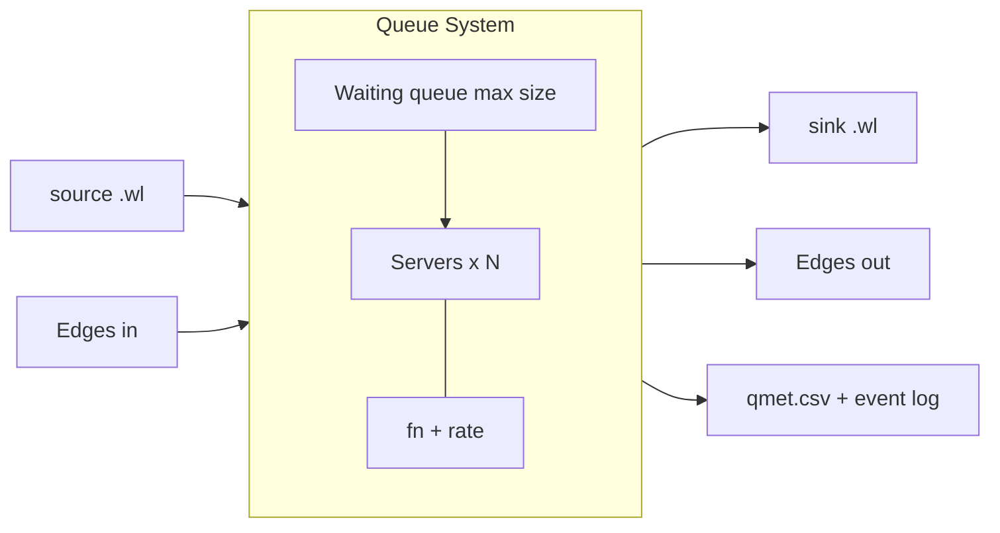
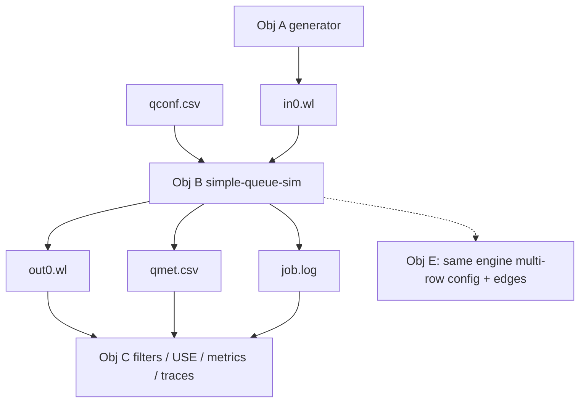

# Objective B — Design: Simple Queue Simulator

## Premise

Objective B builds the discrete-time **queueing simulator** that consumes Obj A workloads and produces metrics/logs for Obj C analysis tools.

Deliverable (from `tasks.md` / Queue Lab slides):

| Tool | Path | Role |
|------|------|------|
| Simple queue sim | `implementation/obj-b/simple-queue-sim/` | C++ CLI: config + source wl → sink wl, `qmet.csv`, event log |

**Language: C++** (required).

### Resource map

| Resource | Use |
|----------|-----|
| [Queue Lab.pdf](../../../Documentation/Resources/Queue Lab.pdf) §B (pp. 6–14) | Queue system model, config schema, server functions, qmet, events |
| Queue Lab.pdf p. 15 | Reference tick sketch (our loop is input-driven; see Main loop below) |
| [q_ex-1.py](../../../Documentation/Resources/example/q_ex-1.py) | Teaching toy for discrete-time intuition (fixed service time — **not** our job model) |
| [server-func.cpp](../../examples/obj-b/server-func.cpp) | `Sub-X` / chain examples on task lists |
| [simple-queue-config-ex.csv](../../examples/obj-b/simple-queue-config-ex.csv) | Single-node Obj B config |
| [multi-queue-config-ex.csv](../../examples/obj-b/multi-queue-config-ex.csv) | Same schema, N nodes (Obj E foreshadow) |
| [events-single.csv](../../examples/obj-b/events-single.csv), [qmet-single.csv](../../examples/obj-b/qmet-single.csv) | Expected event/metric shapes |
| Obj A workload CSV | Source/sink file format |

### Non-goals for this design pass

- No full C++ simulator implementation yet
- No Obj E MTX network loader / pretty-printer
- Do not hard-code “exactly one queue forever” — Obj B is a **network of size 1**

---

## Shared job / workload format (from Obj A)

| Column | Meaning |
|--------|---------|
| `Job Id` | Stable id (`j0`, `j1`, …) |
| `arrival time` | Enter time (source) **or** leave time (sink / completed) |
| `Tasks` | Ordered `"<tid>: W N"` strings; `[]` means done |

Source example (work remaining):

```csv
Job Id,arrival time,Tasks
j0,0,"[""0: W 10"", ""1: W 10""]"
j1,10,"[""0: W 10""]"
j2,20,"[""0: W 10"", ""1: W 10"", ""2: W 10""]"
```

Sink example (completed; `arrival time` = departure time):

```csv
Job Id,arrival time,Tasks
j0,20,[]
j1,30,[]
```

---

## Queue system model (PDF §B)

Each **Queue System** has:

- Waiting queue with **max size**
- **N servers**
- **Server function** + **rate** (apply function once every `rate` time steps while a job is in service)
- Optional **source** workload file (incoming edge from outside)
- Optional **sink** workload file (outgoing edge to outside)
- **Edges in** / **Edges out** to other queue systems (empty for Obj B single-node)



### Config schema

Columns (see examples):

```text
Sys ID, Queue Max Size, Num. Servers, Server Function, Server Function Rate, Source, Sink, Edges in, Edges out
```

Obj B single node:

```csv
Sys ID,Queue Max Size,Num. Servers,Server Function,Server Function Rate,Source,Sink,Edges in,Edges out
q0,8,1,Sub-10,10,in0.wl,out0.wl,[],[]
```

Multi-queue (same loader later):

```csv
q0,16,3,Sub-10,10,in0.wl,,[],[q1,q2]
q1,8,1,Sub-5,5,,out1.wl,[q0],[]
q2,10,4,Sub-10,10,,out2.wl,[q0],[]
```

Architecture rule: parse **all rows** into a `vector<QueueSystem>`. Obj B configs simply have one row and empty edges.

---

## Server functions (PDF pp. 8–9)

A server function takes a task list and returns a mutated task list after each **rate** window.

**Sub-X:** subtract `X` from the first task’s `W N`, or remove the first task if `N <= X`.

| Task-In | Sub-10 → Task-Out |
|---------|-------------------|
| `["0: W 10"]` | `[]` |
| `["0: W 20"]` | `["0: W 10"]` |
| `["0: W 10", "1: W 10"]` | `["1: W 10"]` |
| `[]` | `[]` |

**Chains** (e.g. `Sub-5,Sub-10`): apply each function over successive rate windows (Sub-5 for `rate` steps, then Sub-10 for `rate` steps, …). Reference: `examples/obj-b/server-func.cpp`.

PDF sample assumes **Sub-10\*** — Sub-10 applied 0 or more times until tasks are complete before the job leaves (Obj B single-queue assumption; not always true in multi-queue).

---

## Architecture (multi-queue-ready)

Build Obj B as a **network of size 1**, not a hard-coded single queue class.

```text
[config.csv] ──► Simulator ──► vector<QueueSystem>
                     │
                     ├─► qmet.csv
                     ├─► event log
                     └─► sink workload(s) via each QS
```

Later Obj E adds more `QueueSystem` nodes and routes `DEPART` along edges (equal weight if unspecified) instead of only to a sink.

### Core C++ types

| Type | Responsibility |
|------|----------------|
| `Job` | id, task list, bookkeeping (e.g. time entered current QS) |
| Task helpers | parse/format `"tid: W N"` |
| `ServerFunction` | `TaskList apply(TaskList)`; `SubX`, chain wrapper |
| `Server` | optional job in service; progress / timer toward next function application at `rate` |
| `QueueSystem` | id, max size, waiting deque, servers, fn+rate, source/sink paths, edges in/out, error counter, inbound edge buffer |
| `Simulator` | load config → systems; global clock; tick loop; orchestrate routing |
| `WorkloadIO` | read/write Obj A CSV |
| `EventLog` / `MetricsWriter` | event lines + qmet rows |

**Key rule:** all “how a queue works” logic lives in `QueueSystem` + the PDF tick order in `Simulator`. Obj E should extend routing and config size, not fork a second simulator.

---

## Main loop (input-driven; serve → move → admit)

Loop while **work remains** (source jobs left, waiting queues nonempty, servers busy, or edge buffers nonempty) — not a fixed `time_limit`. Clock still advances one step at a time; termination is driven by draining inputs and in-system jobs (same idea as `temp.psuedocode`).

Within a clock advance (when the next arrival is still in the future):

1. **Serve** — progress jobs already in servers (rate / server function; TASK-END/START)
2. **Move** — finished jobs (`Tasks == []`) exit server → sink file or next queue’s inbound buffer (DEPART-VIA / ERROR NO-OUT-EDGE); then fill idle servers from waiting
3. Write **qmet** for every queue system at this clock, then `clock++`

When arrivals are due at `clock`:

3. **Admit** — pull from each QS source and from inbound edge buffers into that QS waiting queue (ARRIVE-VIA / ERROR QUEUE-FULL); fill idle servers

```text
clock = 0
systems = load_config()   # one QS for Obj B; many for Obj E

while work_remaining(systems):
  if no_arrival_due_at(clock, systems):
    for each Qs: serve busy servers
    for each Qs: move finished jobs to sink or edges_out
    for each Qs: fill idle servers from waiting
    for each Qs: write qmet(clock, Qs, ...)
    clock++
    continue

  for each Qs:
    admit source jobs with arrival == clock
    admit jobs from inbound_buffer          # Obj E; empty on Obj B
    fill idle servers from waiting
```

### Multi-queue I/O and logging

| Concern | How |
|---------|-----|
| Input | Per-QS `Source` workload (sorted); plus `inbound_buffer` fed by upstream DEPART |
| Output | Per-QS `Sink` workload (empty `Tasks`, departure time in arrival column) |
| Events | **One** shared event log; every line includes `qsid` so filters work across the network |
| Metrics | **One** `qmet.csv`; one row per `(clock, queue-sys-id)` for all systems |

Obj B is just `systems.size() == 1` with empty edges; Obj E reuses the same loop.

### Contrast with `q_ex-1.py` / PDF p. 15

- `q_ex-1.py`: fixed `service_time`, single queue, `while clock < limit`
- PDF p. 15 sketch: for-each-QS phases under a time limit (move → update → fill → admit)
- **Our outline:** input-driven stop; **serve → move → admit**; task-list mutation via server functions; N queue systems from day one

### Pseudocode files

- [`simple-queue-sim/simple-queue-sim.pseudo`](simple-queue-sim/simple-queue-sim.pseudo)
- [`../../implementation/obj-b/obj_b.pseudocode`](../../implementation/obj-b/obj_b.pseudocode)

---

## Outputs

### Queue metrics (`qmet.csv`)

Every time step × every queue system:

```csv
time-step,queue-sys-id,num-jobs-in-queue,num-jobs-in-service,num-of-errors
0,0,1,1,0
...
5,0,3,1,1
```

- `num-jobs-in-queue` — waiting (saturation / L)
- `num-jobs-in-service` — occupied servers
- `num-of-errors` — drops this step (or cumulative per PDF examples — match example files when implementing; document choice in impl README)

### Event log

Tokens from PDF pp. 12–13:

```text
<time> <job-id> IN <qsid> ARRIVE-VIA <edge>
<time> <job-id> IN <qsid> DEPART-VIA <edge>
<time> <job-id> IN <qsid> ENTERS-SERVER <sid>
<time> <job-id> IN <qsid> EXITS-SERVER <sid>
<time> <job-id> IN <qsid> TASK-START <tid> <task>
<time> <job-id> IN <qsid> TASK-END <tid> <task>
<time> <job-id> IN <qsid> ERROR <QUEUE-FULL|NO-OUT-EDGE>
```

Sample (matches `examples/obj-b/events-single.csv` / PDF Sub-10\* walkthrough):

```text
0 j0 IN q0 ARRIVE-VIA in0.wl
0 j0 IN q0 ENTERS-SERVER 0
0 j0 IN q0 TASK-START 0 "W 10"
10 j0 IN q0 TASK-END 0 "W 10"
10 j0 IN q0 TASK-START 1 "W 10"
...
```

---

## Worked single-queue walkthrough (sketch)

Config: `q0`, max 8, 1 server, `Sub-10`, rate 10, source `in0.wl`, sink `out0.wl`, no edges.

Source jobs (PDF-style):

| Job | arrival | Tasks |
|-----|---------|-------|
| j0 | 0 | `["0: W 10", "1: W 10"]` |
| j1 | 10 | `["0: W 10"]` |
| j2 | 20 | `["0: W 10", "1: W 10", "2: W 10"]` |

Expected behavior under Sub-10 every 10 steps:

- t=0: j0 arrives, enters server 0, starts task 0
- t=10: task 0 ends, task 1 starts; j1 arrives and waits
- t=20: j0 finishes tasks, exits server, departs to sink; j1 enters service; j2 arrives
- … continue until sources and in-system work are drained

Validate events against `examples/obj-b/events-single.csv` when implementing.

---

## Implementation outline (C++, forthcoming)

Target: `src/implementation/obj-b/simple-queue-sim/`

```text
simple-queue-sim/
  CMakeLists.txt          # or Makefile
  README.md               # build + run
  src/
    main.cpp              # CLI
    job.hpp / job.cpp
    server_function.hpp/.cpp   # Sub-X + "Sub-5,Sub-10" chain
    queue_system.hpp/.cpp
    simulator.hpp/.cpp
    workload_io.hpp/.cpp       # Obj A CSV
    event_log.hpp/.cpp
    metrics_writer.hpp/.cpp    # qmet.csv
```

### CLI sketch

```text
./simple-queue-sim \
  --config qconf.csv \
  [--limit T] \              # optional safety cap; default: run until drained
  --qmet qmet.csv \
  --events job.log
```

Source/sink paths come from the config columns (relative to cwd), matching examples.

### Phased build (later coding)

1. I/O + Job/Task parse; `Sub-X` unit-testable without the clock
2. One `QueueSystem`, one server, source→sink, empty edges (Obj B MVP)
3. Multi-server in one QS; `QUEUE-FULL`; full event vocabulary + qmet
4. Chained server functions + rate timing
5. Edge buffers + weighted routing (unlocks Obj E without rewrite)

---

## Acceptance checklist (eventual C++ MVP)

- [ ] Loads config CSV; builds ≥1 `QueueSystem` (Obj B: one row)
- [ ] Reads Obj A source workload; writes sink workload with empty `Tasks`
- [ ] Discrete clock; loop until inputs/in-system work drain; serve → move → admit
- [ ] Applies `Sub-X` (and documents rate behavior) on jobs in service
- [ ] Emits `qmet.csv` and event log matching lab token formats
- [ ] Reports `QUEUE-FULL` when waiting queue cannot accept an arrival
- [ ] Types/structure leave room for N systems + edges (no single-queue-only dead ends)

---

## How Obj B fits the lab


