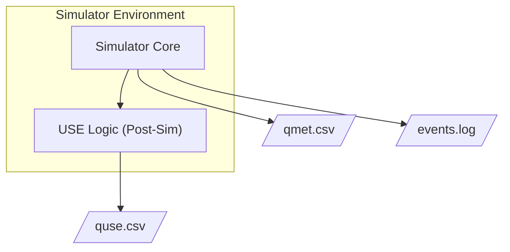
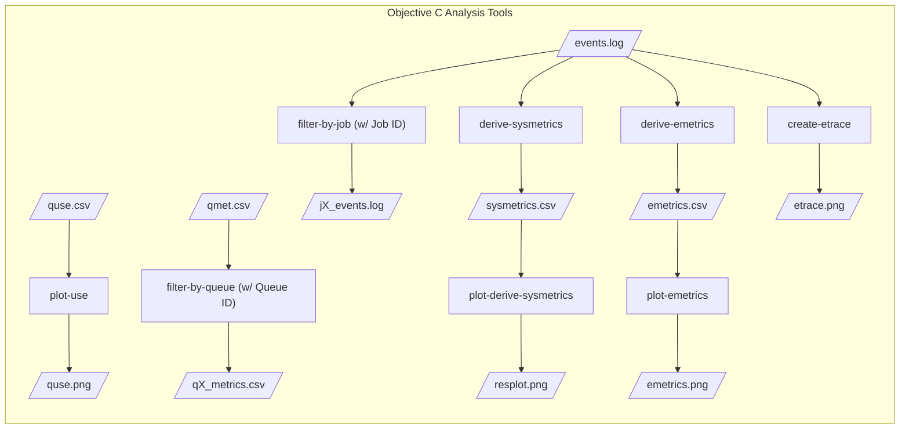

# Objective C — Design: Analysis Tools & Trace Visualization

## Premise

Objective C builds the data analysis and visualization pipeline that consumes the logs (`qmet.csv` and the events log `events.log`) produced by the queueing simulator from Objective B. It provides modular tools to filter data, calculate USE (Utilization, Saturation, Errors) metrics, derive system and event performance metrics, and generate visual event traces.

### Resource map

| Resources | Use |
|----------|-----|
| [Queue Lab](../../../Documentation/Resources/Queue Lab.pdf) | USE metric formulas, event trace specifications, filter parameters |
| [`qmet-single.csv`](../../examples/obj-b/qmet-single.csv) / [`events-single.csv`](../../examples/obj-b/events-single.log) | Expected input formats generated by Obj B (simulated by a single-queue system) |
|[`quse-ex.csv`](../../examples/obj-c/USE/quse-ex.csv) / [`sysmetrics-ex.csv`](../../examples/obj-c/sysmetrics/sysmetrics-ex.csv) / [`emetrics-ex.csv`](../../examples/obj-c/events/emetrics-ex.csv) | Expected output formats generated by correlating features |
| [`quse.png`](../../examples/obj-c/USE/use.png) / [`resplot.png`](../../examples/obj-c/sysmetrics/resplot.png) / [`emetrics-*.png`](../../examples/obj-c/events/) / [`etrace-sketch.png`](../../examples/obj-c/events/etrace-sketch.png) | Expected plots generated by CSV outputs from Obj-C |
---

## Input Data Model (from Obj B)

Objective C tools operate exclusively on the two standard outputs defined in Objective B:

### 1. Queue Metrics (`qmet.csv`)
Used for USE metrics and queue saturation analysis. Columns include time-step, queue-sys-id, num-jobs-in-queue, num-jobs-in-service, and num-of-errors.

### 2. Event Log
Used for event metrics, job lifecycle tracing, and pretty-printing. Follows the standard token structure: `<time> <job-id> IN <qsid> <EVENT> ...`. Events include `ARRIVE-VIA`, `DEPART-VIA`, `ENTERS-SERVER`, `EXITS-SERVER`, `TASK-START`, `TASK-END`, and `ERROR`.

---

## Tooling Architecture

