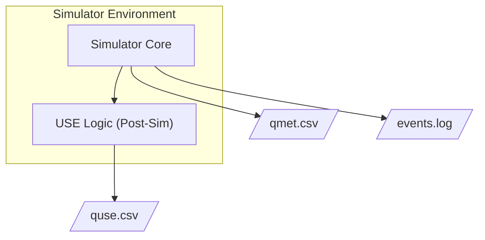

# Objective C — Design: Analysis Tools & Trace Visualization

## Premise

Objective C builds the Python-based data analysis and visualization pipeline that consumes the logs (`qmet.csv` and the event log) produced by the queueing simulator from Objective B. It provides modular tools to filter data, calculate USE (Utilization, Saturation, Errors) metrics, derive system and event performance metrics, and generate visual event traces.

Deliverable (from `tasks.md` / Queue Lab slides):

| Tool | Path | Role |
|------|------|------|
| Analysis scripts | `implementation/obj-c/analysis/` | Python CLI: parse Obj B logs → generate filtered CSVs, metric reports, and trace plots |

**Language: Python** (required).

### Resource map

| Resource | Use |
|----------|-----|
| [Queue Lab.pdf](../../../Documentation/Resources/Queue Lab.pdf) §C | USE metric formulas, event trace specifications, filter parameters |
| `etrace-sketch.py` / `pp-events.py` | Reference logic for matplotlib Gantt charts and terminal alignment |
| `qmet-single.csv` / `events-single.csv` | Expected input formats generated by Obj B |

### Non-goals for this design pass

- No simulation execution or state management (Obj B responsibility)
- No workload generation or sink file creation (Obj A and Obj B responsibilities)

---

## Input Data Model (from Obj B)

Objective C tools operate exclusively on the two standard outputs defined in Objective B.

### 1. Queue Metrics (`qmet.csv`)
Used for USE metrics and queue saturation analysis. Columns include time-step, queue-sys-id, num-jobs-in-queue, num-jobs-in-service, and num-of-errors.

### 2. Event Log
Used for event metrics, job lifecycle tracing, and pretty-printing. Follows the standard token structure: `<time> <job-id> IN <qsid> <EVENT> ...`. Events include `ARRIVE-VIA`, `DEPART-VIA`, `ENTERS-SERVER`, `EXITS-SERVER`, `TASK-START`, `TASK-END`, and `ERROR`.

---

## Tooling Architecture



```mermaid
flowchart LR
  qmet["qmet.csv"] --> parser
  events["job.log"] --> parser

  subgraph objc ["Obj C Analysis Pipeline"]
    direction TB
    parser["Log Parsers"] --> filters["Filters"]
    filters --> use["USE Metrics Calculator"]
    filters --> sys_metrics["System & Event Metrics"]
    filters --> trace["Event Tracing (Plotter)"]
    filters --> pp["Pretty Printer"]
  end

  use --> out_metrics["metrics_report.txt"]
  sys_metrics --> out_metrics
  trace --> out_png["etrace-plot.png"]
  pp --> out_term["pp-events.txt"]