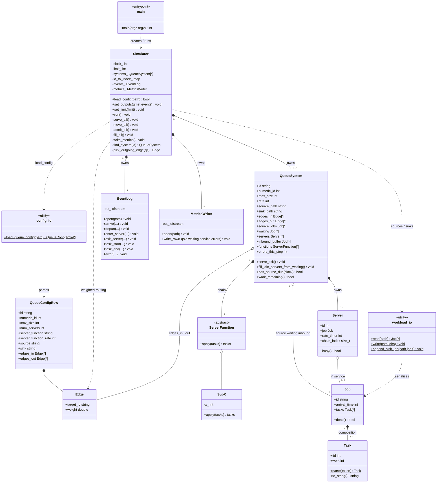

# Objective B — `simple-queue-sim`

C++ discrete-time queue simulator (boilerplate scaffold).

Design / algorithm: [`../../design/obj-b/README.md`](../../design/obj-b/README.md)  
Pseudocode: [`../obj_b.pseudocode`](../obj_b.pseudocode)

## Status

Skeleton only — types, CLI parse, and stubs. Core serve → move → admit loop is not implemented yet.

## Build

```bash
cmake -S . -B build
cmake --build build
```

Binary: `build/simple-queue-sim` (path may vary by generator).

## CLI

```text
./simple-queue-sim --config qconf.csv [--limit T] --qmet qmet.csv --events job.log
```

Runs until sources and in-system work are drained (`--limit` is an optional safety cap). Source/sink paths come from the config CSV.

## Layout and file responsibilities

How the pieces fit together (UML class architecture):



### Requirements coverage (PDF §B + pseudocode)

| Requirement | Where it lives |
|-------------|----------------|
| Queue sys id, max size, # servers, fn, rate, source, sink, edges in/out | `QueueConfigRow` / `config_io` → `QueueSystem` |
| Edge weights (equal if unspecified) | `Edge.weight`; `Simulator::pick_outgoing_edge` |
| Source workload file → jobs | `workload_io::read` → `QueueSystem::source_jobs` |
| Sink workload file | `workload_io::append_sink_job` on DEPART to sink |
| Incoming edges between queues | `inbound_buffer` + `edges_in` / routing in `move_all` |
| Sub-X + chains at rate | `ServerFunction` / `SubX`; `Server::rate_timer` / `chain_index` |
| Serve → move → admit loop; stop when drained | `Simulator::run` + `work_remaining` (pseudocode) |
| qmet.csv columns | `MetricsWriter::write_row` (`numeric_id`) |
| Event tokens ARRIVE/DEPART/SERVER/TASK/ERROR | `EventLog` (emit **TASK-END** to match PDF sample / examples; PDF bullet also says TASK-STOP) |
| QUEUE-FULL / NO-OUT-EDGE | `EventLog::error`; `errors_this_step` |
| Server id in logs | `Server::id` |
| Multi-queue ready | `systems_` + `id_to_index_` + edge routing |

Open design choices (not blockers for Obj B MVP):

- Whether edge-buffer jobs admitted same clock as DEPART or next clock
- Whether `--limit` is required by graders or only a safety cap
- Exact qmet `num-of-errors`: per-step count (examples look per-step) vs cumulative

### `CMakeLists.txt`
Tells CMake how to compile every `.cpp` into the `simple-queue-sim` binary. No simulation logic.

### `src/main.cpp`
Program entry point. Parses `--config`, `--limit`, `--qmet`, `--events`, builds a `Simulator`, points it at the output files, and starts the run. Does **not** contain queueing logic — only wiring.

### `src/config_io.hpp` / `config_io.cpp`
Parses the queue **configuration CSV** (PDF §B columns) into `QueueConfigRow` / `Edge` values, including optional edge weights. Does not build runtime queues — `Simulator::load_config` does that.

### `src/job.hpp` / `job.cpp`
Defines what a **job** is in memory: id, arrival time, and its list of **tasks** (`"0: W 10"` → tid + work). Responsible for turning CSV task strings into structs and back. Used everywhere a job is stored or printed; does not know about queues or the clock.

### `src/server_function.hpp` / `server_function.cpp`
Defines **how a server does work** on a job’s task list. Implements `Sub-X` (subtract work from the front task, or remove it) and parses config strings like `Sub-10` or `Sub-5,Sub-10` into a chain. Pure transformation: given tasks in, return tasks out. Does not own servers or time.

### `src/queue_system.hpp` / `queue_system.cpp`
One **queueing node** (e.g. `q0`): loaded `source_jobs`, waiting line (max size), N servers, source/sink paths, weighted edges, inbound buffer from other queues, and local error counts. Holds per-node helpers (`serve_tick`, fill, `work_remaining`). Obj B usually has one; Obj E has many.

### `src/simulator.hpp` / `simulator.cpp`
The **orchestrator**. Loads config into `systems_` + `id_to_index_`, owns the global `clock`, runs serve → move → admit across **all** queues, routes DEPART along weighted edges, and writes shared `EventLog` / `MetricsWriter` output.

### `src/workload_io.hpp` / `workload_io.cpp`
File I/O for Obj A **workload CSVs**. Reads a source file into jobs; appends completed jobs to a sink (`Tasks == []`, departure time in the arrival column). Serialization only.

### `src/event_log.hpp` / `event_log.cpp`
Shared **event log** for all queue systems. One line per state change; includes `qsid` (and `sid` for servers). Obj C greps this later.

### `src/metrics_writer.hpp` / `metrics_writer.cpp`
Writes **`qmet.csv`**: each clock tick, one row per queue system (waiting / in service / errors).

## Architecture note

`Simulator` owns N `QueueSystem`s from day one. Obj B configs have one row and empty edges; Obj E adds rows and routing without a second engine.
