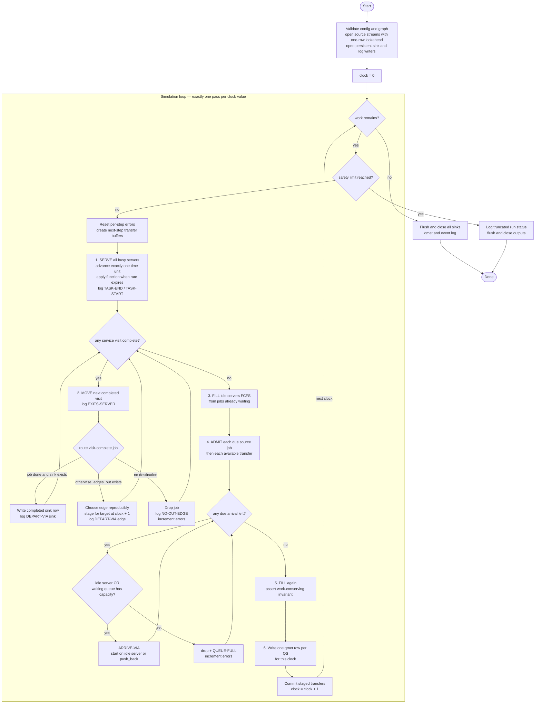
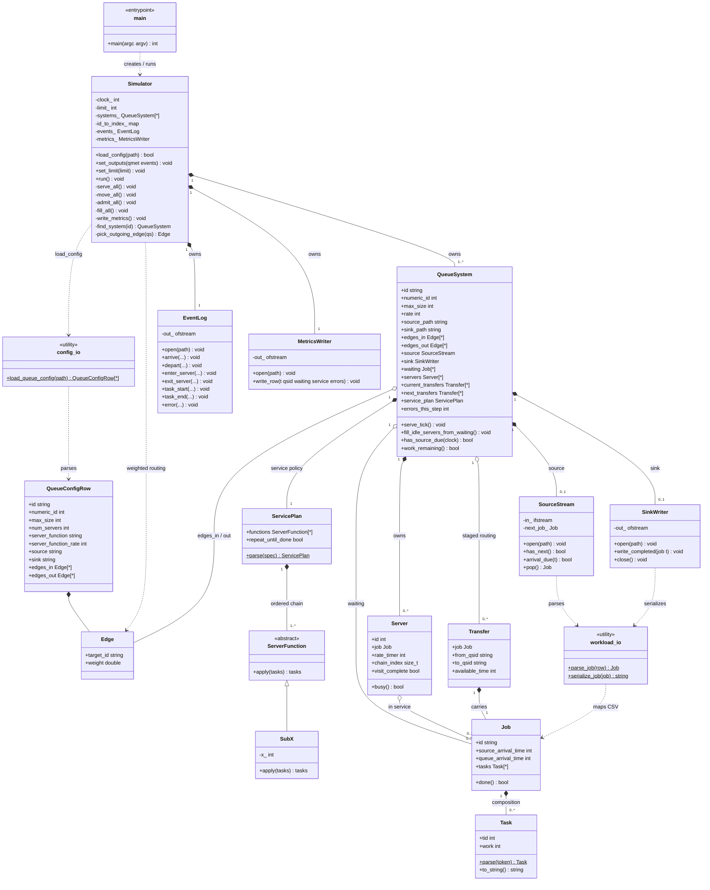

# Objective B — `simple-queue-sim`

C++ discrete-time queue simulator.

Design / algorithm: [`../../design/obj-b/README.md`](../../design/obj-b/README.md)  
Pseudocode: [`../obj_b.pseudocode`](../obj_b.pseudocode)

## Status

Implemented. Canonical tick order: **serve → move → fill → admit → fill → record**. Emits `TASK-END` (not `TASK-STOP`). Network-ready (`vector<QueueSystem>` + staged transfers) with Obj B configs using one row.

## Build

```bash
cmake -S . -B build
cmake --build build
```

Binary: `build/simple-queue-sim` (path may vary by generator).

## Test

```bash
ctest --test-dir build --output-on-failure
# or (Linux / Git Bash / WSL):
./run-all-tests.sh
# or (Windows PowerShell):
.\run-all-tests.ps1
```

Coverage: Job/Sub-X/config unit tests; PDF walkthrough golden events+sink; `QUEUE-FULL`; multi-server; bare chain visit vs job-done; 2-node transfer smoke.

## CLI

```text
./simple-queue-sim --config qconf.csv [--limit T] --qmet qmet.csv --events job.log
```

Runs until sources and in-system work are drained (`--limit` is an optional safety cap). Source/sink paths come from the config CSV.

### Quick run (existing workload)

PowerShell (from `simple-queue-sim/`):

```powershell
.\scripts\run-existing.ps1
.\scripts\run-existing.ps1 -Workload ..\..\..\examples\obj-a\wl-poisson.csv
```

Or build once and invoke the binary with a one-node config whose `Source` column points at any Obj A CSV.

### Generate → visualize → simulate

```powershell
.\scripts\gen-viz-sim.ps1
.\scripts\gen-viz-sim.ps1 -Interval 0:49 -Dist uniform -Seed 7
```

Bash/WSL equivalents: `scripts/run-existing.sh`, `scripts/gen-viz-sim.sh`.


## Simulator flowchart

The simulator executes one complete, deterministic cycle for each simulation time. Termination is input-driven: stop only when every source is exhausted, every waiting/inbound queue is empty, and every server is idle (or when the optional safety limit is reached).

The phase order is deliberately **serve → move → fill → admit → fill → record**. It preserves the team's backwards-processing approach while matching the examples: work already in the system is resolved before arrivals stamped with the same time are admitted. The second fill allows a new arrival to enter an idle server immediately, as `j0` does at time 0 in the PDF.



### Timing and ordering contract

These rules remove ambiguity from the flowchart:

1. A clock value is processed **once**; admitting jobs never causes a second pass at the same time.
2. Existing service completes before arrivals with that timestamp are admitted. This gives the PDF sample ordering at $t=10$: task end/start, then `j1 ARRIVE-VIA`.
3. FCFS is deterministic. For simultaneous arrivals, process queue systems in config order, source rows in file order, then incoming transfers in stable source-system/server order.
4. A transfer produced at time $t$ becomes admissible at $t+1$. Staging transfers prevents results from depending on the order of queue systems in `systems_`.
5. `Queue Max Size` applies to **waiting jobs only**; jobs in service are counted separately. During admission, use an idle server immediately; otherwise consume waiting capacity. This avoids dropping work while service capacity is available.
6. Errors in qmet are the number generated by that queue **during that time step**; reset after the row is emitted.

### Job completion versus service-visit completion

These are different states:

- **Service visit complete:** the configured function or function chain for this queue has finished. The job exits this server. If it still has tasks, route it to an outgoing queue.
- **Job done:** `Tasks == []`. If this queue has a sink, write the completed job there. Otherwise, route along an outgoing edge when one exists, as directed by PDF p. 15. A sink must not receive unfinished work.

For the Section B sample, `Sub-10*` means repeat `Sub-10` at each rate window until the task list is empty, so visit completion and job completion happen together. A future Obj E stage such as `Sub-10` without `*` may complete its visit after one application and forward the partially processed task list. Represent this explicitly as a parsed `ServicePlan` (ordered functions plus `repeat_until_done`) instead of inferring completion from `Tasks` alone.

### Task event semantics

The PDF's event-list page calls the stop event `TASK-STOP`, while its sample and the repository examples use `TASK-END`. The simulator will emit `TASK-END` for compatibility. At every completed rate window, end the current service interval; if the same task still has remaining work, emit a new `TASK-START` with its updated work. If the task was removed, start the new front task when service continues. This gives Obj C enough boundaries to derive time in service without pretending that partial work completed the whole job.

### Efficiency design

The required qmet file contains one row for every time step and queue. That makes dense time iteration part of the observable output, so the baseline implementation should prioritize exact semantics over unsafe event jumps.

| Technique | Why |
|-----------|-----|
| **Dense clock as baseline** | Advance by exactly one step so service timers, event timestamps, and sliding-window USE inputs remain correct. |
| **Safe idle jump only** | Jump directly to the next source arrival only when all servers, waiting queues, and transfer buffers are empty. Emit the required zero-state qmet rows for skipped times; never jump over active service. |
| **`std::deque` for waiting / source / inbound** | O(1) push_back / pop_front — correct for FCFS. |
| **`unordered_map` id → QS index** | O(1) edge routing (multi-queue). |
| **Streaming sources, one-row lookahead** | Keep only the next parsed job from each sorted source; do not load a million-job Obj F workload or rescan the file. |
| **Active-server index (future optimization)** | At Obj F scale, maintain busy server indices so service work is proportional to active servers. Start with a simple server scan for correctness. |
| **Two transfer buffers** | Current and next-step buffers guarantee deterministic routing without copying the whole network. |
| **Buffered log writes** | `ofstream` with infrequent flush; avoid per-event `endl` flush storms on large runs. |

Because qmet itself requires $Q \times T$ rows, runtime has an unavoidable $\Omega(QT)$ output cost. Simulation work should add only $O(S_{active}+A+D)$ per step for active servers, admissions, and departures.

### Queueing-theory design

Align the engine with what Obj C/D/F will measure (USE, throughput, response time, sensitivity, and Little’s Law):

| Principle | How the sim enforces it |
|-----------|-------------------------|
| **FCFS / FIFO waiting** | `waiting` is a deque; admit at back, dispatch from front. |
| **Work-conserving** | After MOVE and after ADMIT, always `fill_idle_servers_from_waiting` so a free server never idles while the queue is nonempty. |
| **Clear service mechanism** | Service is the server-function/rate model (Sub-X), not a hidden random draw — reproducible, analyzable. |
| **Saturation L** | `num-jobs-in-queue` = waiting length only (not in service), matching PDF / USE “saturation”. |
| **Utilization** | `num-jobs-in-service / Num.Servers` recoverable from qmet each step. |
| **Arrivals / departures** | Event log ARRIVE-VIA / DEPART-VIA gives arrival rate $\lambda$ and throughput. Preserve source arrival separately from per-queue visit times so end-to-end latency and per-queue response time are both derivable. |
| **Stability awareness** | Finite `max_size` + QUEUE-FULL models a finite buffer (loss system); document that overflow jobs are errors, not silent delays. |
| **Little’s Law check** | For stable, non-loss intervals, compare time-average jobs in system $L$ with measured throughput $\lambda$ and mean time in system $W$: $L \approx \lambda W$. Include waiting plus service for system-level $L$. |
| **Warm-up / drain effects** | Sections D/F compare scales and resource changes. Label warm-up, steady-state, and drain intervals; do not interpret startup/drain averages as steady-state behavior. |
| **Reproducible routing** | Weighted routing must use a configured seed or deterministic weighted round-robin so sensitivity studies can be compared fairly. |
| **Multi-class later** | Keep `Job`/`Task` generic so Obj E networks stay the same engine. |

Admission never bypasses an older waiting job: phase 3 first dispatches all existing FCFS work. In phase 4, each new arrival can use only a server still idle after that dispatch; otherwise it joins the tail or is dropped when the waiting buffer is full.

## Layout and file responsibilities

How the pieces fit together (UML class architecture). Implemented under `src/`;
`ServicePlan`, `Transfer`, `SourceStream`, and `SinkWriter` are first-class types:



### Requirements coverage (PDF §B + pseudocode)

| Requirement | Planned owner |
|-------------|----------------|
| Queue sys id, max size, # servers, fn, rate, source, sink, edges in/out | `QueueConfigRow` / `config_io` → `QueueSystem` |
| Edge weights (equal if unspecified) | `Edge.weight`; `Simulator::pick_outgoing_edge` |
| Source workload file → jobs | per-QS `SourceStream` with sorted one-row lookahead |
| Sink workload file | persistent per-QS `SinkWriter` on DEPART to sink |
| Incoming edges between queues | current/next `Transfer` buffers + `edges_in`; each transfer retains source and availability time |
| Sub-X + chains / `*` at rate | `ServicePlan`; `ServerFunction` / `SubX`; `Server::rate_timer`, `chain_index`, `visit_complete` |
| Serve → move → fill → admit → fill → record; stop when drained | `Simulator::run` + `work_remaining` (flowchart / pseudocode) |
| qmet.csv columns | `MetricsWriter::write_row` (`numeric_id`) |
| Event tokens ARRIVE/DEPART/SERVER/TASK/ERROR | `EventLog` (emit **TASK-END** to match PDF sample / examples; PDF bullet also says TASK-STOP) |
| QUEUE-FULL / NO-OUT-EDGE | `EventLog::error`; `errors_this_step` |
| Server id in logs | `Server::id` |
| Multi-queue ready | `systems_` + `id_to_index_` + staged, weighted edge routing |

### Resolved policy decisions

- **Inter-queue delay:** a departure at $t$ is staged and admitted at $t+1$.
- **Termination:** run until drained; `--limit` is an optional safety guard.
- **qmet errors:** per-step dropped-job count, reset after each row.
- **qmet density:** one row per queue per time step, as Section B requires.
- **Task event token:** emit `TASK-END` to match the PDF sample and repository
  examples (the preceding PDF bullet calls the same event `TASK-STOP`).
- **Routing reproducibility:** deterministic weighted round-robin by default;
  a seeded random policy may be added explicitly, never hidden randomness.

### Configuration and runtime invariants

Fail before simulation if queue ids are duplicated, an edge target is missing, edge weights are non-positive, `Num. Servers <= 0`, `Server Function Rate <= 0`, `Queue Max Size < 0`, a server-function token is unknown, or a source workload is malformed/unsorted. Report `NO-OUT-EDGE` when a visit-complete job has neither a valid done-job sink nor an outgoing edge. The safety limit protects against cyclic networks or service plans that can never finish, but invalid zero-progress plans should be rejected during configuration.

### `CMakeLists.txt`
Tells CMake how to compile every `.cpp` into the `simple-queue-sim` binary. No simulation logic.

### `src/main.cpp`
Program entry point. Parses `--config`, `--limit`, `--qmet`, `--events`, builds a `Simulator`, points it at the output files, and starts the run. Does **not** contain queueing logic — only wiring.

### `src/config_io.hpp` / `config_io.cpp`
Parses the queue **configuration CSV** (PDF §B columns) into `QueueConfigRow` / `Edge` values, including optional edge weights. Does not build runtime queues — `Simulator::load_config` does that.

### `src/job.hpp` / `job.cpp`
Defines what a **job** is in memory: id, original source arrival, current-queue arrival, and tasks (`"0: W 10"` → tid + work). Keeping both timestamps allows Obj C to derive end-to-end and per-queue metrics without overloading the sink CSV's `arrival time` field.

### `src/server_function.hpp` / `server_function.cpp`
Defines **how a server does work** on a job’s task list. Implements `Sub-X` and parses `Sub-10`, `Sub-5,Sub-10`, and repeat marker `*` into a `ServicePlan`. The pure functions mutate work; the plan/server decides when a service visit is complete.

### `src/queue_system.hpp` / `queue_system.cpp`
One **queueing node** (e.g. `q0`): streaming source, FCFS waiting line, N servers, service plan, source/sink paths, weighted edges, two staged transfer buffers, and per-step errors. Two buffers prevent queue iteration order from changing whether a transfer is visible at time $t$ or $t+1$.

### `src/simulator.hpp` / `simulator.cpp`
The **orchestrator**. Loads config into `systems_` + `id_to_index_`, owns the global `clock`, runs serve → move → fill → admit → fill → record across **all** queues, routes DEPART along weighted edges, and writes shared `EventLog` / `MetricsWriter` output.

### `src/workload_io.hpp` / `workload_io.cpp`
File I/O for Obj A workload CSVs. `SourceStream` keeps one parsed lookahead job so large inputs are not loaded into memory. `SinkWriter` remains open and buffers completed rows (`Tasks == []`, departure time in the arrival column). Shared helpers parse/serialize `Job`; none of these types performs simulation.

### `src/event_log.hpp` / `event_log.cpp`
Shared **event log** for all queue systems. One line per state change; includes `qsid` (and `sid` for servers). Obj C greps this later.

### `src/metrics_writer.hpp` / `metrics_writer.cpp`
Writes **`qmet.csv`**: each clock tick, one row per queue system (waiting / in service / errors).

## Architecture note

`Simulator` owns N `QueueSystem`s from day one. Obj B configs have one row and empty edges; Obj E adds rows and routing without a second engine.
